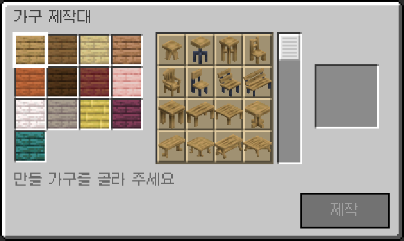
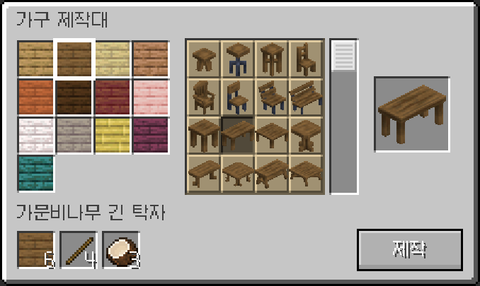
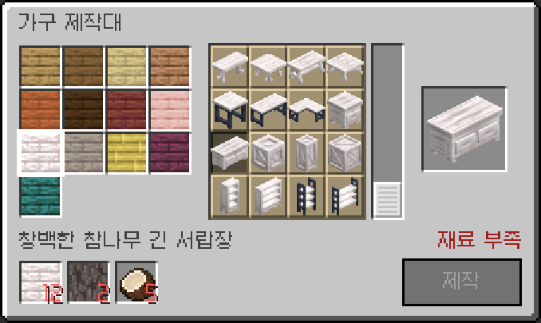

# 가구 제작대 (`/coreui furniture`)

석재 절단기처럼 생긴 바닐라 컨테이너 스타일 화면입니다. 나무를 고르고, 그 나무로 만들 가구를 고르면 필요한 재료가 나오고 `제작`을 누르면 코코넛과 재료가 빠지고 가구(Nexo 아이템)를 받습니다. 재료 수치는 임시입니다.

| 처음 | 제작 가능 | 재료 부족 (목록을 내린 상태) |
| :---: | :---: | :---: |
|  |  |  |

## 여는 방법

- `/coreui furniture` — 자기 화면 열기 (권한 `coreui.demo`, OP)
- `/coreui furniture <플레이어>` — 다른 사람에게 열어 주기 (권한 `coreui.furniture.others`, 콘솔용)
- **가구 제작대 우클릭**: Nexo 가구 `tmf_worktable`의 `clickActions`가 콘솔에서 위 명령을 실행합니다.
  테스트 서버 `plugins/Nexo/items/toomanyfurniture.yml` (`D:/kokonut/tools/toomanyfurniture/tmf_convert.py`가 생성):

  ```yaml
  clickActions:
    - actions:
        - "[console] coreui furniture <player>"
  ```

## 화면 (`menu/furniture/FurnitureMenu`, 226×135)

- **왼쪽 — 나무 13종**(바닐라 11종 + 창백한 참나무·포플러나무): 판자 아이콘 칸, 한 줄에 4개. 고른 나무에 흰 테두리. 나무를 바꿔도 고른 가구는 유지됩니다.
- **가운데 — 가구 28종**: 한 줄에 4개, 4줄씩 보입니다. 스크롤 막대의 손잡이 위·아래를 누르면 한 화면씩 넘어갑니다(다이얼로그는 휠·드래그를 받을 수 없음).
- **오른쪽 — 미리보기**: 고른 가구의 32px 그림.
- **아래**: 가구 이름, 재료 칸(필요 개수가 칸 안에 표시되고, 부족하면 빨간색), `제작` 버튼. 재료 칸에 마우스를 올리면 필요 개수와 보유 개수가 나옵니다.
  - 보유 개수는 인벤토리(보관 칸 36개)의 **평범한 아이템** 수입니다. 이름을 바꾸거나 인챈트된 아이템은 세지 않고 쓰지도 않습니다. 코코넛은 Core의 `CurrencyUtil.snapshot` 값입니다(불러오는 중이면 제작 불가).

## 제작 (`menu/kokonut/FurnitureCrafts`)

상점 구매(`ShopTrades`)와 같은 순서입니다.

1. 재료가 있는지, 가구가 들어갈 자리가 있는지 확인합니다.
2. Core 화폐 API로 코코넛을 뺍니다(`CurrencyUtil.takeKokonut`, 메인 스레드 밖에서 실행, 사유 `furniture:craft`). 잔액이 모자라면 Core가 거절합니다.
3. 메인 스레드로 돌아와 재료를 빼고 가구를 줍니다. 결제하는 사이에 접속을 끊었거나 재료가 바뀌었으면 코코넛을 돌려줍니다.

한 사람이 동시에 한 번만 제작할 수 있습니다. Kokonut-Core나 Nexo가 꺼져 있으면 안내만 하고 아무것도 빼지 않습니다.

## 재료 (`menu/furniture/FurnitureCatalog`)

- **코코넛**: 앉을 수 있거나(의자·스툴·벤치) 보관함이 있는(상자·서랍장·선반) 가구는 **5개**, 나머지(탁자·책상)는 **3개**. Core의 실제 코코넛 재화입니다.
- **나무**: 고른 나무의 판자·원목·막대기. 크고 무거운 가구일수록 많이 듭니다. 원목은 진홍빛·뒤틀린은 자루, 대나무는 대나무 블록입니다. **아래 수치는 임시입니다.**

| 가구 | 코코넛 | 판자 | 원목 | 막대기 | | 가구 | 코코넛 | 판자 | 원목 | 막대기 |
| --- | ---: | ---: | ---: | ---: | --- | --- | ---: | ---: | ---: | ---: |
| 스툴 | 5 | 1 | | 3 | | 야외 탁자 | 3 | 4 | | 4 |
| 모던 스툴 | 5 | 2 | | 2 | | 큰 야외 탁자 | 3 | 8 | | 8 |
| 높은 스툴 | 5 | 1 | | 4 | | 책상 | 3 | 4 | | 2 |
| 의자 | 5 | 2 | | 4 | | 긴 책상 | 3 | 8 | | 4 |
| 고급 의자 | 5 | 3 | 1 | | | 모서리 책상 | 3 | 6 | | 3 |
| 모던 의자 | 5 | 3 | | 2 | | 서랍장 | 5 | 6 | 1 | |
| 벤치 | 5 | 3 | | 4 | | 긴 서랍장 | 5 | 12 | 2 | |
| 긴 벤치 | 5 | 6 | | 6 | | 상자 | 5 | 6 | | |
| 탁자 | 3 | 3 | | 4 | | 높은 상자 | 5 | 12 | | |
| 긴 탁자 | 3 | 6 | | 4 | | 큰 상자 | 5 | 24 | | |
| 큰 탁자 | 3 | 12 | | 4 | | 선반 | 5 | 4 | | 2 |
| 고급 탁자 | 3 | 3 | 1 | | | 긴 선반 | 5 | 8 | | 4 |
| 고급 긴 탁자 | 3 | 6 | 2 | | | 모던 선반 | 5 | 4 | 1 | |
| 고급 큰 탁자 | 3 | 12 | 4 | | | 긴 모던 선반 | 5 | 8 | 2 | |

결과 아이템은 Nexo 아이템 `tmf_<나무>_<종류>`(`FurnitureCatalog.itemId`)입니다.

## 그림

다이얼로그 글자에는 3D 모델을 넣을 수 없어서, 가구 모델을 인벤토리와 같은 각도로 미리 그린 그림을 글리프로 씁니다.

- `tools/furniture_icons.py` — Nexo 팩의 TooManyFurniture 모델·텍스처를 읽어 `art/furniture/icon/*.png`(32px, 화면 16px)와 `art/furniture/preview/*.png`(64px, 화면 32px) 364장씩을 만듭니다. 모델이나 텍스처를 바꾸면 다시 돌립니다.

  ```
  py -I tools/furniture_icons.py [Nexo 폴더]     # 기본 D:/egoverse/home1/plugins/Nexo
  py -I tools/dex_glyphs.py                      # bundled-glyphs/furniture/ 로 복사 + UI 이미지 + bundled-glyphs.yml
  ```

- `tools/dex_glyphs.py`의 `furniture_glyphs()` — 배경 패널(나무 칸, 목록 자리, 스크롤 홈, 미리보기 칸 포함), 조합법 버튼, 스크롤 손잡이, 재료 칸, 제작 버튼을 바닐라 색으로 그립니다.
- 가구 그림은 728장이라 폰트를 한 자리(y % 9 == 2)만 만듭니다(`bundled-glyphs.yml`의 `offsets: [2]`, 바닐라 아이템 아이콘과 같은 규칙). 다른 자리에 그리면 메뉴를 만들 때 오류가 납니다.
- 미리보기: `java -cp "build/classes/java/main;build/resources/main;<컴파일 클래스패스>" tools/MenuPreview.java "%APPDATA%/.minecraft/versions/26.3/26.3.jar" docs/shop-preview furniture`

## 남은 것

- 나무 재료 수치는 임시입니다.
- 한 번에 하나씩만 만듭니다(여러 개 제작 없음).
- 인게임 확인 전입니다: 글자 위치·그림자·아이콘 선명도, 그리고 실제 제작(코코넛 차감, 재료 차감, 가구 지급, 부족할 때 안내).
