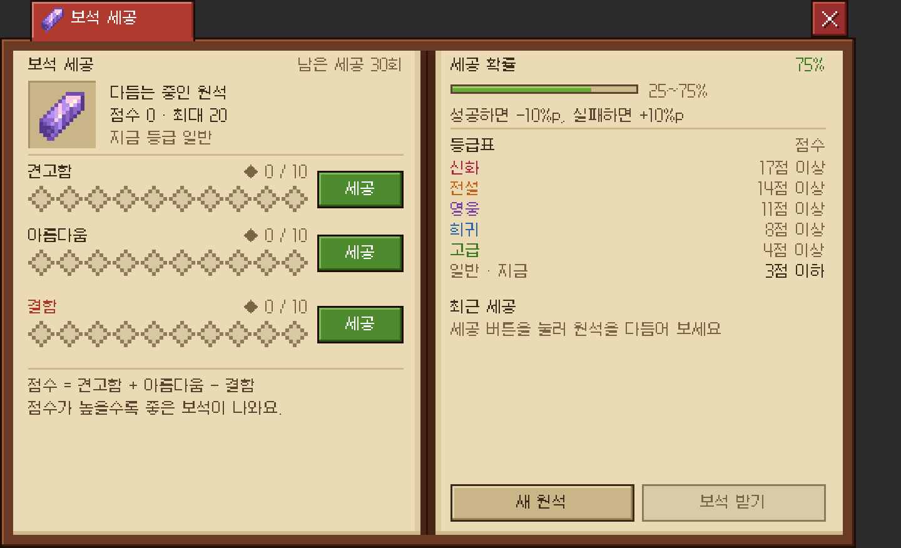
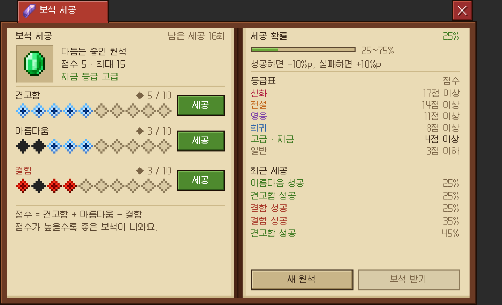
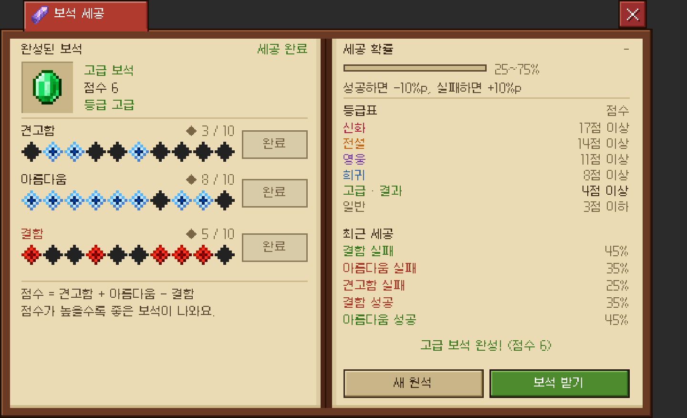

# 보석 세공 프로토타입 (`/coreui gem`)

원석을 세 줄(견고함 · 아름다움 · 결함)로 다듬고, 점수가 높을수록 좋은 등급의 보석이 나오는 화면입니다. 칭호·마을 화면과 같은 책 레이아웃이고, 권한은 다른 프로토타입처럼 `coreui.demo`(OP)입니다.

| 시작 | 세공 중 | 완성 |
| :---: | :---: | :---: |
|  |  |  |

## 규칙 (`menu/gem/GemCutting`)

- 줄마다 10칸, 모두 30번 세공합니다. 세공할 줄은 플레이어가 고릅니다.
- 성공 확률은 세 줄이 함께 씁니다. **75%**에서 시작하고, 성공하면 −10%p, 실패하면 +10%p 움직이며 25~75% 안에 머뭅니다.
  - 그래서 확률이 높을 때는 견고함·아름다움을, 낮을 때는 결함을 누르는 판단이 핵심입니다.
- **점수 = 견고함 성공 + 아름다움 성공 − 결함 성공** (−10 ~ 20점)
- 등급(점수 기준, `GemCutting.Grade`에서 바꿀 수 있음):

| 등급 | 점수 | 아이콘(임시) |
| --- | --- | --- |
| 신화 | 17점 이상 | 네더의 별 |
| 전설 | 14~16점 | 바다의 심장 |
| 영웅 | 11~13점 | 엔더 진주 |
| 희귀 | 8~10점 | 다이아몬드 |
| 고급 | 4~7점 | 에메랄드 |
| 일반 | 3점 이하 | 자수정 조각 |

## 화면 (`menu/gem/GemMenu`)

- **왼쪽 페이지**
  - 위: 지금 점수로 나올 보석 아이콘(32px), 점수와 최대로 올릴 수 있는 점수, 지금 등급.
  - 세 줄: 이름, 성공 수, 10칸, `세공` 버튼(다 채우면 `완료`). 칸은 견고함·아름다움이 성공하면 파란 별, 결함이 성공하면 빨간 다이아몬드, 어느 줄이든 실패하면 검은 다이아몬드입니다.
- **오른쪽 페이지**
  - 세공 확률(막대와 %), 등급표(지금 등급 표시), 최근 세공 5개(점수에 좋은 결과는 초록, 나쁜 결과는 빨강).
  - `새 원석`: 처음부터 다시. `보석 받기`: 30칸을 다 채우면 눌러서 완성(지금은 채팅 안내만).

## 새 글리프

- `gem/ui/facet_good`(파란 별), `facet_bad`(빨간 다이아몬드), `facet_miss`(검은 다이아몬드): 원본 그림 `art/gem/*.png`(16×16)를 `tools/dex_glyphs.py`의 `gem_glyphs()`가 그대로 복사합니다. 그림을 바꾸려면 `art/gem/`의 파일을 바꾸고 생성기를 다시 돌리세요.
- `gem/ui/facet_empty`(빈 칸): 같은 모양으로 생성기가 그립니다.
- 서버에 처음 넣을 때는 `/coreui reload`로 리소스 팩을 다시 만들어야 칸이 보입니다.

## 아직 프로토타입인 것

- 원석은 서버 메모리에만 있고, 나가면 사라집니다. 재료 소모와 보석 아이템 지급이 없습니다.
- 실제로 연결하려면 정할 것: 원석·세공 재료(비용), 완성 보석 아이템(Nexo 아이템 ID)과 쓰임새(장신구 소켓 등), 세공 기록 저장 여부.
