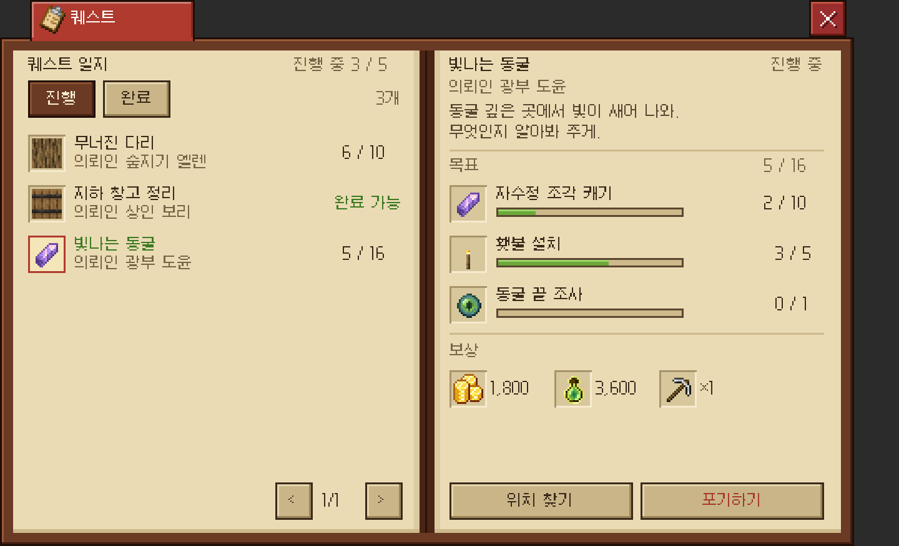
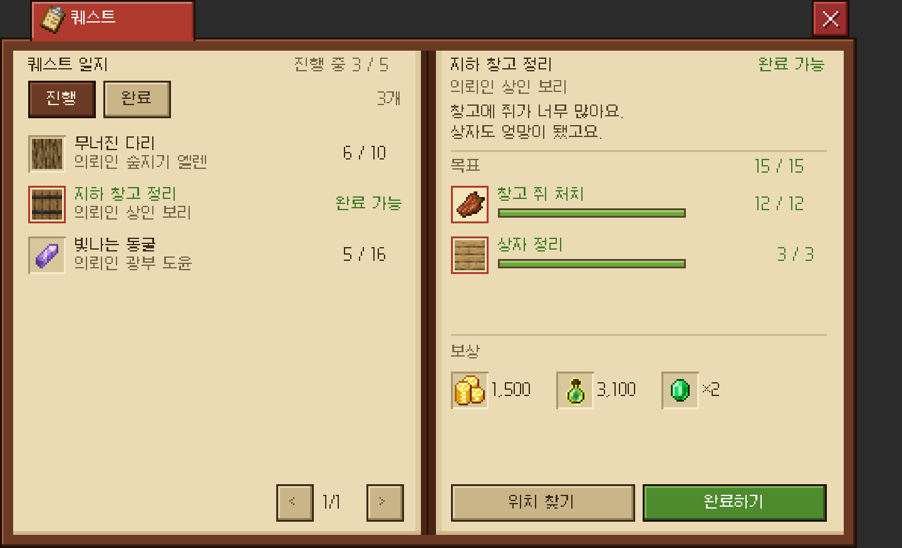
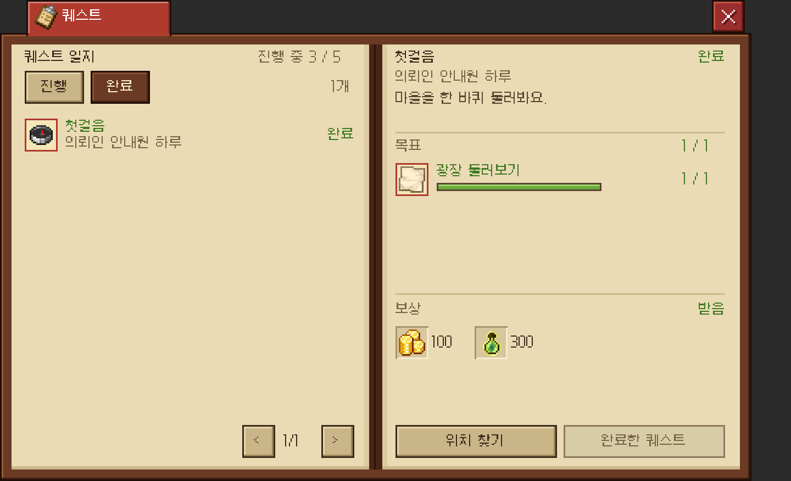
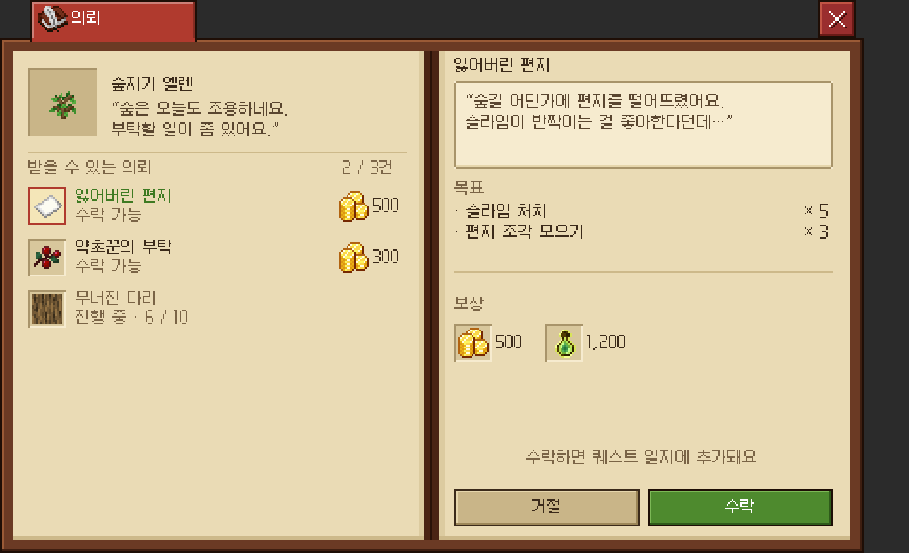
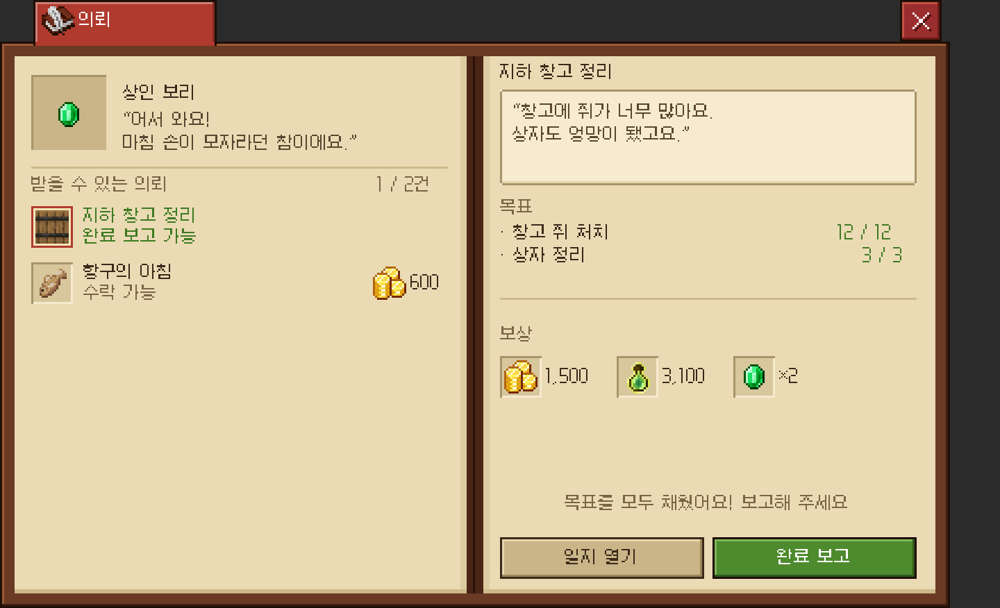

# 퀘스트 프로토타입: 퀘스트 일지와 NPC 의뢰

- **퀘스트 일지**(`/coreui quest`, 메인 메뉴 → 퀘스트): 진행 중이거나 완료한 퀘스트를 봅니다(`menu/quest/QuestMenu`).
- **NPC 의뢰**(`/coreui quest npc <giver> [플레이어]`): NPC가 의뢰를 보여 주고, 여기서 수락합니다(`QuestOfferMenu`).
  - 콘솔·NPC 명령으로 다른 플레이어에게 열 수 있습니다(`coreui.quest.others`). 예: Citizens NPC 콘솔 명령 `coreui quest npc elen %player%`
  - 샘플 NPC: `elen`, `bori`, `doyun`, `haru`
- 서버에 레벨 개념이 없어 레벨은 쓰지 않습니다. 장소 대신 **의뢰인 NPC**로 표시합니다.
- 이전 641px 프로토타입(`menu/demo/QuestPrototype`, 서버 `Glyphs/proto` 32장)은 삭제했습니다. 백업은 `plugin-backups/CoreUi/quest-proto-*`에 있습니다.

| 일지 · 진행 중 | 일지 · 완료 가능 | 일지 · 완료 |
| :---: | :---: | :---: |
|  |  |  |

| NPC 의뢰 · 수락 전 | NPC 의뢰 · 완료 보고 |
| :---: | :---: |
|  |  |

## 퀘스트 일지

- **왼쪽 페이지**: "퀘스트 일지", "진행 중 n / 5", 필터 `진행 · 완료`(도감 필터와 같은 dark/paper 버튼)가 있습니다.
  - 7줄 목록: 아이콘, 이름, "의뢰인 ○○"를 보여 주고, 오른쪽에 `진행/전체`, "완료 가능", "완료" 중 하나를 표시합니다.
  - 칭호 화면과 같은 위치에 페이지 넘김이 있습니다.
- **오른쪽 페이지**: 진행 상황 중심입니다. 도감·칭호의 장면 프레임은 쓰지 않습니다.
  - 이름과 상태, 의뢰인, 설명 2줄이 나옵니다.
  - 목표는 최대 3개이고, 각각 슬롯 아이콘, 도감 진행 바(`bar_100`), `n / m`으로 보여 줍니다. 다 채운 목표는 초록 테두리 슬롯입니다.
  - 보상은 슬롯과 수량을 가로로 나열합니다(골드, 경험치, 아이템). 마우스를 올리면 이름이 나옵니다.
  - 버튼은 `위치 찾기` 그리고 `포기하기`, `완료하기`, `완료한 퀘스트` 중 하나입니다.

## NPC 의뢰

- **왼쪽 페이지**: NPC 칸(우물 칸, 대표 아이템), 이름, 인사말 2줄, "받을 수 있는 의뢰 n / m건"이 있습니다.
  - 그 NPC의 의뢰 목록(최대 5개)을 상태와 함께 보여 줍니다: 수락 가능(골드 보상 표시), 진행 중 n/m, 완료 보고 가능, 완료함.
- **오른쪽 페이지**: 의뢰 이름, NPC 말풍선(새 글리프 `quest/ui/speech_200`), 목표(`× 5` 또는 진행 수), 보상, 안내 문구가 이어집니다.
  - 버튼은 상태에 따라 `거절 / 수락`, `일지 열기 / 완료 보고`, `일지 열기 / 진행 중`, `일지 열기 / 완료함`입니다. 진행 중인 퀘스트가 5개면 `진행 칸 가득`이 나옵니다.

## 새 글리프

- `quest/ui/speech_200`(말풍선)
- `dex/ui/btn_paper_98`

나머지는 모두 기존 키트(책, 탭, 슬롯, 도감 바, 버튼, 우물 칸, 구분선)를 재사용합니다.
글자는 y % 9 == 8 위치에 두지 않습니다(게임에서 잘림).

## 아직 프로토타입인 것

- 데이터는 `QuestCatalog.SAMPLE`(NPC 4명, 퀘스트 7개)입니다.
- 수락·포기·완료는 `QuestProgress`(서버 메모리)에만 저장되어, 서버를 재시작하면 초기화됩니다. 진행 수는 샘플 값으로 고정되어 있고, 보상은 지급하지 않습니다.
- "위치 찾기"는 안내 메시지만 보냅니다.
- 실제 퀘스트 플러그인과 연결하려면 Core 칭호처럼 서비스(퀘스트 목록, 상태, 수락·포기·완료)를 정해야 합니다.
