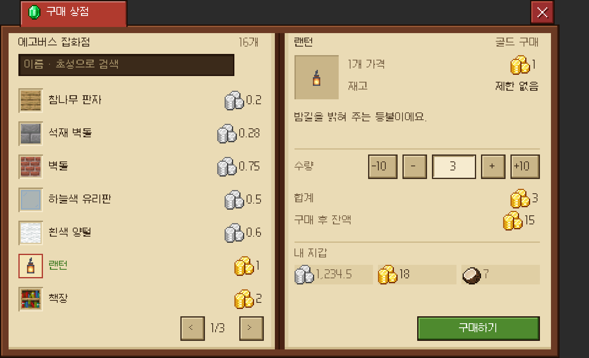
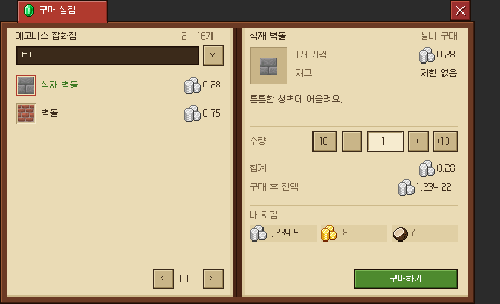
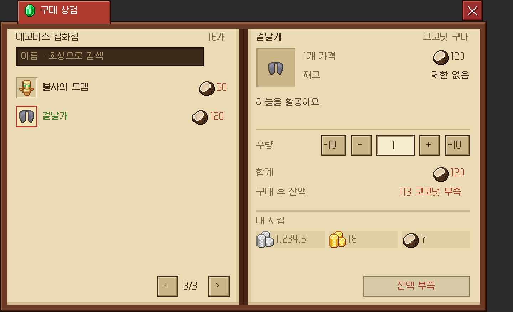
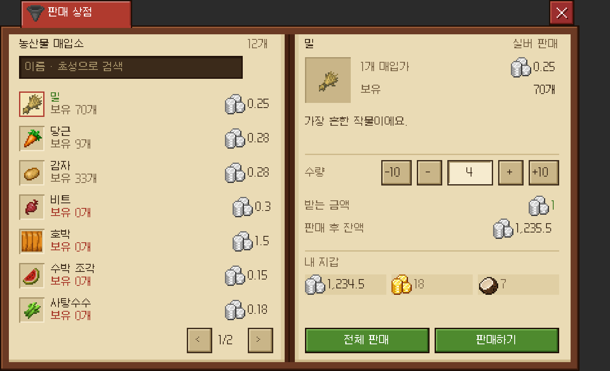
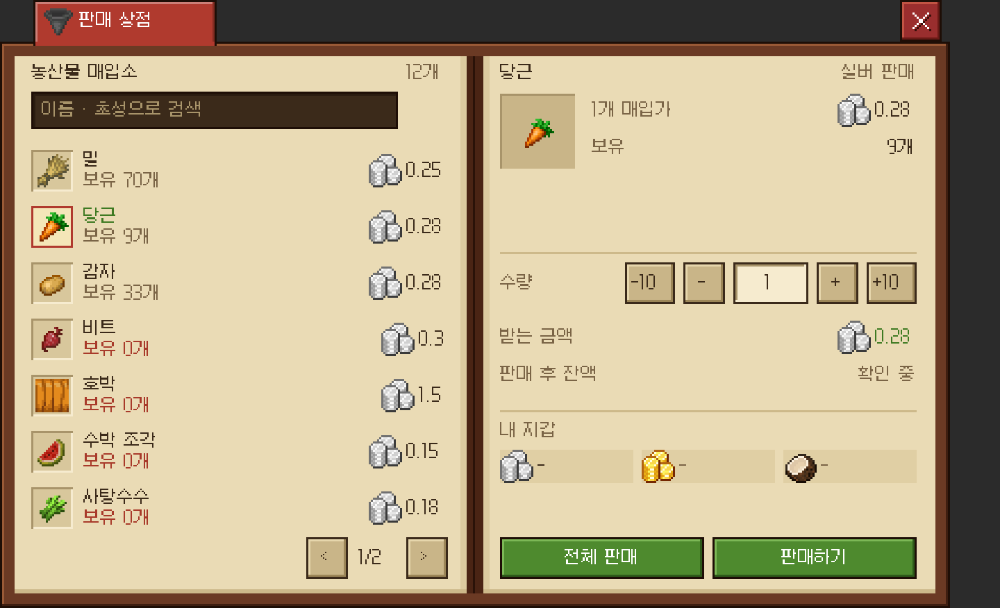

# 상점 UI (`/coreui shop <id> [플레이어]`)

상점 화면은 칭호 화면(`TitleMenu`)과 같은 책 레이아웃입니다. 상점마다 **구매 전용**이나 **판매 전용** 중 하나로 정하고, 카테고리 없이 목록 하나에 **검색**을 붙였습니다.
상점은 `plugins/Kokonut_UI/shops.yml`에 정의합니다(기본: 구매 상점 `general`, 판매 상점 `farm`). 수정한 뒤 `/coreui reload`로 다시 읽습니다.
`/coreui shop <id>`는 자기 자신에게 상점을 엽니다(`coreui.shop`, 기본 OP).
`/coreui shop <id> <플레이어>`는 다른 플레이어에게 엽니다(`coreui.shop.others`, 기본 OP). 콘솔에서도 쓸 수 있으니 Citizens NPC 콘솔 명령 `coreui shop general %player%`처럼 연결하면 됩니다.
`/상점`은 Kokonut_ChestShop이 이미 쓰고 있어서 `/coreui` 하위 명령으로 열었습니다.

| 구매 상점 | 구매 · 초성 검색 "ㅂㄷ" | 구매 · 잔액 부족 |
| :---: | :---: | :---: |
|  |  |  |

| 판매 상점 | 판매 · 보유 부족 + 잔액 확인 중 |
| :---: | :---: |
|  |  |

미리보기는 `tools/ShopPreview.java`가 `shops.yml`과 실제 `ShopMenu.build` 결과(요소 위치, 글리프, 글자)를 PNG로 그린 것입니다.
글자는 galmuri11.ttf를 AWT로 근사해서 그렸으므로 클라이언트와 1px 안팎으로 다를 수 있습니다.

```
gradlew build
java -cp "build/classes/java/main;build/resources/main;<compile classpath>" tools/ShopPreview.java "%APPDATA%/.minecraft/versions/26.3/26.3.jar" docs/shop-preview [hotspots]
```

## 기존 메뉴 스타일 정리 (상점이 따르는 규칙)

| 항목 | 기존 규칙 (출처) | 상점 |
| :--- | :--- | :--- |
| 크기 | 책 화면 480×292 GUI px, `noBackground`, DARK 테마 (도감·우편함·칭호) | 같음 |
| 책 | `dex/ui/page_{0,1}_{0,1}`을 (0/228, 20)과 (0/228, 153)에 그림. 아래 타일은 9px 줄 경계에서 시작 | 재사용 |
| 제목 탭 | `menu/ui/tab`(빨간 가죽 88px)을 (16,0)에, 아이콘을 (20,2)에, 흰 글자를 (38,6)에 두고 `menu/ui/tab_join`으로 책과 이음 (우편함·칭호) | 재사용. 구매는 에메랄드, 판매는 호퍼 아이콘 |
| 닫기 | `dex/ui/close`를 (432,0)에 | 재사용 |
| 페이지 칸 | 왼쪽 x=15, 오른쪽 x=240, 폭 200, 머리글 y=31, 아래 버튼 y=258 | 같음 |
| 검색 | 어두운 `menu/ui/field_176`을 (15,44)에. 힌트는 #A8946A, 입력값은 #F6ECD0. 지우기 `x` 버튼(paper 20). 누르면 Paper 대화창 입력 → `TitleSearch`(대소문자·공백 무시, 초성) (칭호) | 재사용. `TitleSearch.filter` 그대로 |
| 목록 줄 | 7줄, y = 72·99·…·234. 슬롯 `dex/ui/slot_normal|selected` + 바닐라 아이콘(+2,+2, y%9==2), 묶음 수는 오른쪽 아래 흰 글자, 1줄 y+1, 2줄 y+11 (칭호) | 같음 |
| 페이지 넘김 | `<` (15+132), `n/m`, `>` (15+180), paper 20 (칭호) | 같음 |
| 버튼 | `dex/ui/btn_{paper,green,off}_{20,24,60,100}`, 글자는 가운데 y+6 | 재사용. 실행은 green 100, 비활성은 off 100 |
| 글자색 | INK #3B2A1A, DIM #7A6446, BODY #5A4630, GREEN #3E7A22, RED #A83A2A, WHITE, PAPER #F6ECD0, HINT #A8946A | 이 색만 사용 |
| 재화 아이콘 | 메인 메뉴의 16px `menu/icon/{silver,gold,kokonut}` (`art/icons`) | 재사용 |
| 칩 바탕 | `chip_70`·`profile_bg`의 #E0CFA4, 16px 높이 (메인 메뉴) | `shop/ui/chip_64`: 같은 색, 폭만 64 |
| 구분선 | 메인 메뉴 패널 구분선 #CDB98A 1px | `shop/ui/divider_200`: 같은 색 |
| 입력 칸 | 슬롯 팔레트 bevel (`head_frame_20`) | `shop/ui/qty_36`: 같은 bevel |
| 아이템 상세 | `menu/ui/well` 36px 우물 칸 (메인 메뉴) | 재사용 |
| 레이어 | 글리프는 위쪽이 걸친 9px 줄에 매달리며, 아래 줄이 나중에 그려짐. 생성기가 ascent min(8, h)를 씀 | 같은 생성기(`tools/dex_glyphs.py`의 `shop_glyphs()`) |

새로 만든 글리프는 `shop/ui/chip_64`, `qty_36`, `divider_200` 세 개뿐이며, 모두 기존 팔레트와 bevel 함수로 만들었습니다. 기존 PNG는 바이트 단위로 그대로입니다.

## 화면 구성

- **왼쪽 페이지**: 상점 이름과 상품 수(검색 중이면 `2 / 16개`), 검색칸, 상품 7줄, 페이지 넘김.
  - 각 줄은 아이콘, 이름, 둘째 줄, 오른쪽 16px 재화 아이콘과 가격으로 되어 있습니다.
  - 둘째 줄은 구매 상점이면 `N개 묶음`, 판매 상점이면 `보유 N개 · N개씩`(모자라면 빨간색)입니다.
  - 구매 상점에서 잔액이 모자라면 가격이 빨간색입니다.
- **오른쪽 페이지**: 선택 상품의 우물 칸, 단위, 가격(매입가), 재고(판매 상점은 보유 수), 설명 2줄이 나옵니다.
  - 수량은 `-10 · - · n · + · +10`(1~64 단위)이고, 판매 상점은 보유 수만큼으로 제한됩니다.
  - 받는 개수(넘기는 개수), 합계(받는 금액), 구매·판매 후 잔액이 이어집니다.
  - "내 지갑"에는 세 재화 칩이 있고, 상품 통화는 진하게 표시합니다.
  - 버튼은 `구매하기`·`판매하기`, 또는 비활성 `잔액 부족`·`보유 부족`·`잔액 확인 중`입니다.

## 결정한 것

- 카테고리 없이 상점마다 상품 목록 하나를 두고, 검색으로 좁힙니다(사용자 요청).
- `ShopCatalog.Mode`로 **구매 전용**(`BUY`)과 **판매 전용**(`SELL`) 상점을 구분합니다(사용자 요청). 표현은 플레이어 기준이라, BUY 상점에서는 플레이어가 삽니다.
- 통화는 상품마다 지정합니다(`Product.currency`).
- 재화 아이콘은 9px 미니 대신 메인 메뉴의 16px 아이콘을 씁니다(사용자 요청).
- 잔액은 `CurrencyUtil.snapshot`으로 읽습니다(`CoreBalance.wallet`). snapshot은 표시용이라 결제 승인에 쓰면 안 됩니다.
- 판매 상점의 보유 수는 인벤토리 저장 칸에서 **메타 없는 바닐라 아이템**(`isSimilar`)만 셉니다.
- 기본 `shops.yml`의 상품은 구매 16개(`general`), 판매 12개(`farm`)이며, 모두 아이콘이 있는 바닐라 키만 썼습니다.

## 거래 처리 (`menu/kokonut/ShopTrades`)

Core의 `CurrencyUtil.take*`/`add*`는 DB를 직접 호출하므로, Core의 `/재화` 명령처럼 비동기 스레드에서 실행하고 인벤토리 작업은 메인 스레드에서 합니다.
기록에는 `CurrencyChangeContext("shop:<id>", "상점 구매|판매 <상점> · <상품> N개", 플레이어)`가 남습니다.

- **구매**는 다음 순서로 진행합니다.
  1. 저장 칸 36개에 들어갈 자리가 있는지 확인합니다.
  2. 재화를 차감합니다. 잔액이 모자라면 Core가 거절합니다.
  3. 아이템을 지급합니다. 그 사이 칸이 차면 남는 아이템은 발밑에 떨어뜨립니다.
  - 결제 직후 플레이어가 접속을 끊었다면 금액을 환불합니다.
- **판매**는 저장 칸에서 메타가 없는 바닐라 아이템을 회수한 뒤 재화를 지급합니다. 지급이 실패하면 회수한 아이템을 돌려줍니다.
- 한 플레이어당 거래는 동시에 하나만 진행됩니다. 끝나면 상점이 아직 열려 있을 때 화면을 다시 그립니다.
- 가격 검증: 골드·코코넛 가격은 정수만, 실버 가격은 소수 둘째 자리까지 허용합니다. 잘못된 상품은 경고 로그를 남기고 건너뜁니다.

## 남은 것

- 인벤토리가 가득 찰 때 우편으로 보내는 기능은 아직 없습니다. 대신 구매 전에 칸을 확인하고, 막지 못한 경우에만 떨어뜨립니다.
- Nexo·커스텀 아이템 상품, 재고와 매입 한도, 가격 변동은 아직 없습니다.
- 잔액 표시는 snapshot을 쓰므로, 거래 직후 다시 그린 화면에 한 박자 늦은 값이 보일 수 있습니다. 실제 결제는 Core가 다시 확인합니다.
- 거래가 진행 중일 때 버튼 모양은 바뀌지 않습니다. 중복 클릭은 무시됩니다.
- 수량 버튼이 한계에 닿으면 클릭은 막히지만, 모양은 활성 버튼과 같습니다(칭호·우편함 페이지 버튼과 같은 방식).
