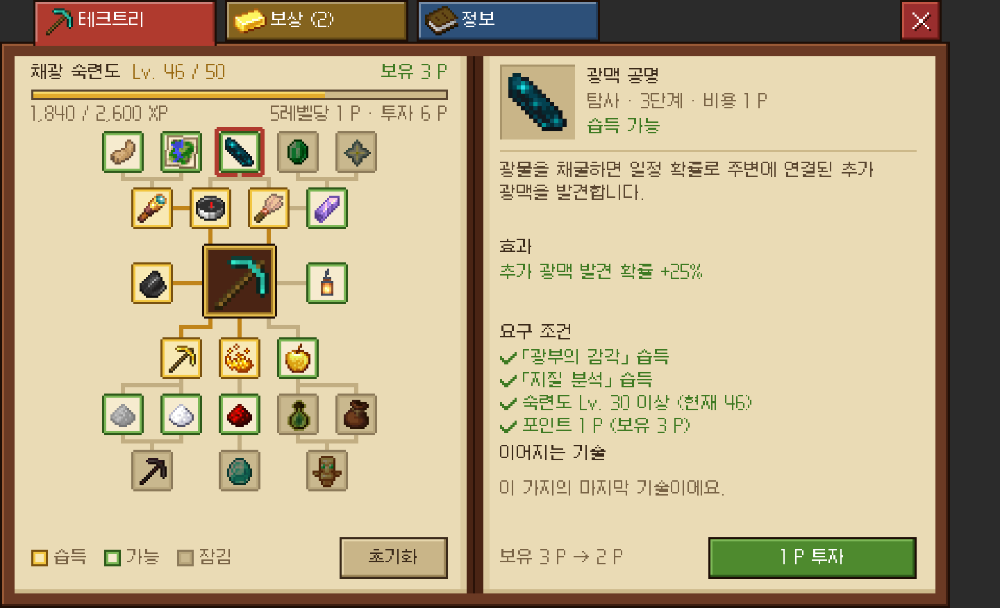
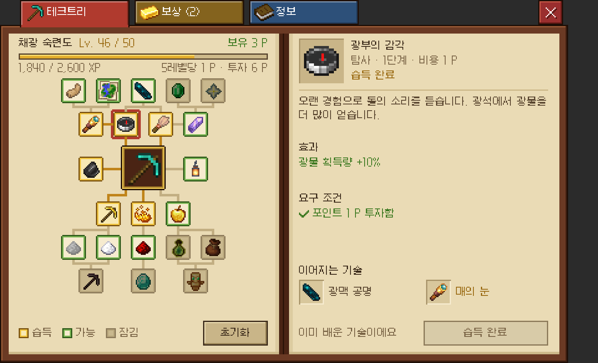
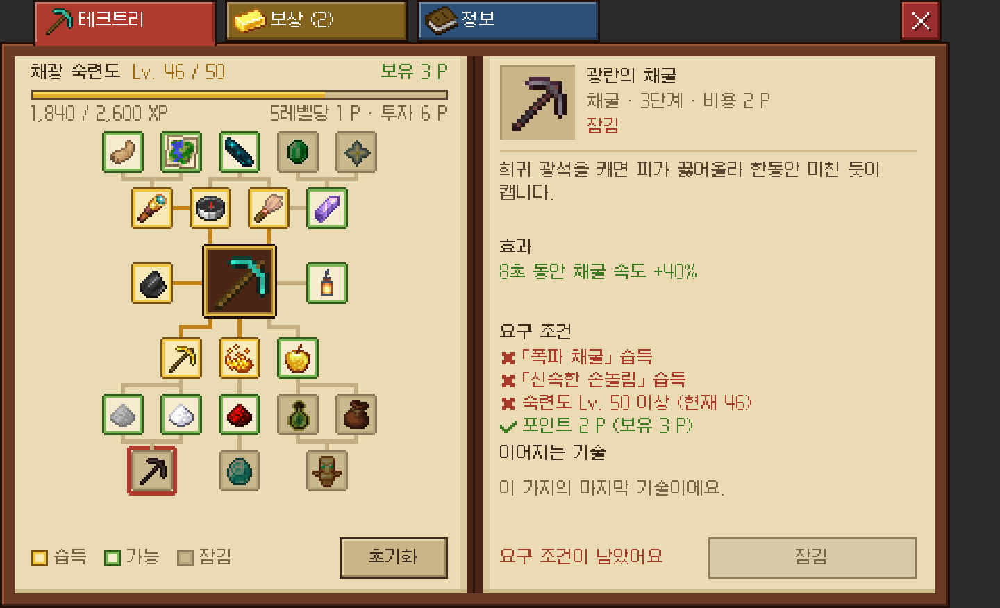
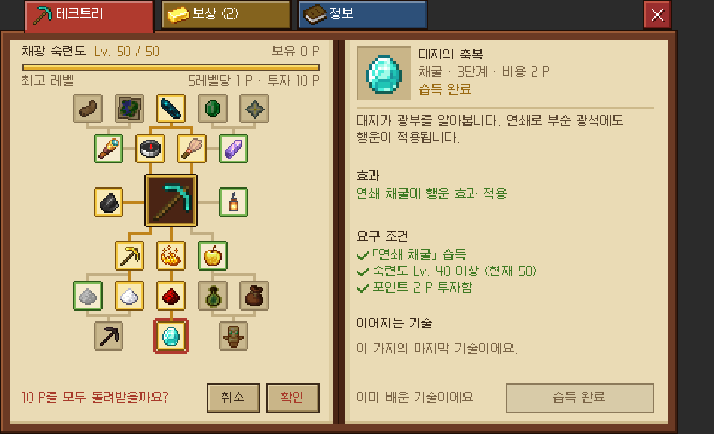
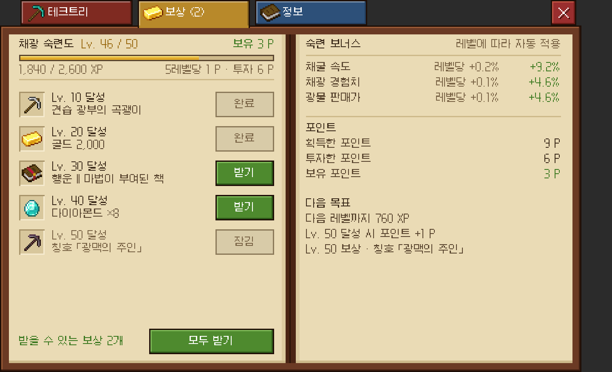
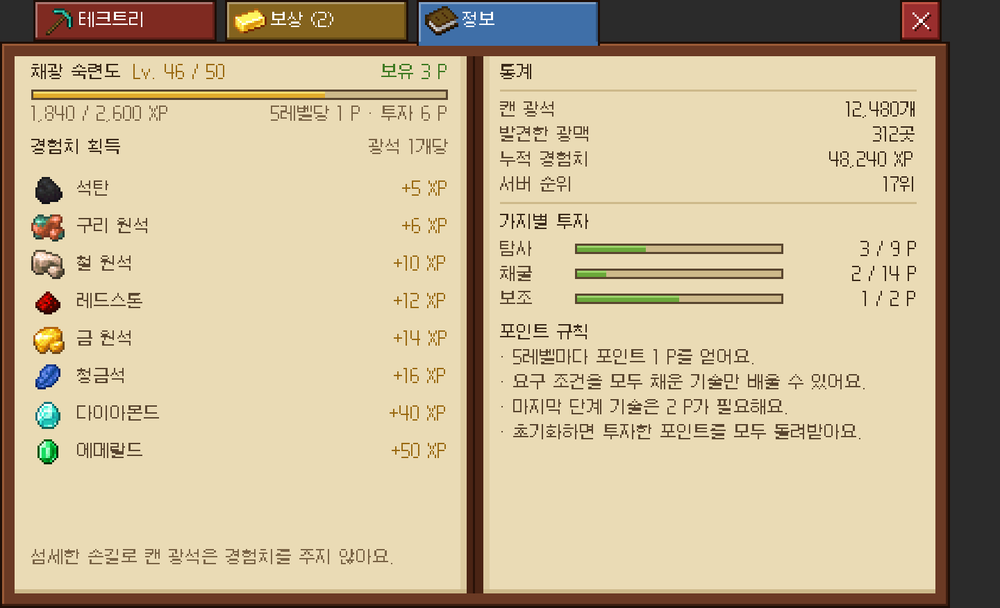

# 숙련도 화면 프로토타입 (`/coreui skill`)

채광 숙련도의 테크트리·레벨 보상·정보를 보여 주는 화면입니다(`menu/skill/SkillMenu`). 다른 Kokonut 화면과 같은 책(`BookCanvas`) 위에 그립니다.
`/coreui skill`로 엽니다(권한 `coreui.demo`, 기본값 OP).

| 테크트리 (습득 가능) | 습득 완료 | 잠김 | 초기화 확인 |
| :---: | :---: | :---: | :---: |
|  |  |  |  |

| 보상 | 정보 |
| :---: | :---: |
|  |  |

## 화면

탭은 `테크트리`(빨강) · `보상`(금) · `정보`(파랑) 세 개입니다. 받을 보상이 있으면 보상 탭에 개수가 붙습니다("보상 (2)").
왼쪽 페이지 위쪽에는 어느 탭에서나 **레벨, 경험치 바, 경험치 수치, 보유·투자 포인트**가 나옵니다.

- **테크트리**
  - 왼쪽 페이지: 가운데 곡괭이에서 위(탐사)·아래(채굴)·양옆(보조)으로 뻗는 22개 기술입니다.
    - 테두리 색이 상태입니다: 금색 = 습득, 초록 = 지금 배울 수 있음, 회색(아이콘도 어둡게) = 잠김. 아래에 범례가 있습니다.
    - 선택한 기술에는 빨간 테두리가 **덧씌워져서**, 선택 중에도 상태 색이 보입니다.
    - 습득한 기술로 이어지는 연결선은 금색입니다.
    - `초기화`는 한 번 더 확인합니다("6 P를 모두 돌려받을까요?" → `취소` / `확인`).
  - 오른쪽 페이지: 선택한 기술의 아이콘·이름, 가지·단계·비용, 상태, 설명, 효과, **요구 조건**입니다.
    - 요구 조건은 선행 기술, 필요 레벨, 포인트를 각각 ✔/✘로 보여 줍니다. 무엇이 모자란지 바로 알 수 있습니다.
    - `이어지는 기술`을 누르면 그 기술로 넘어갑니다.
    - 버튼은 배울 수 있을 때만 초록 `1 P 투자`이고, 왼쪽에 투자 후 포인트가 나옵니다("보유 3 P → 2 P").
- **보상**
  - 왼쪽 페이지: Lv. 10~50 레벨 보상 5개와 `받기` / `완료` / `잠김`, 아래에 `모두 받기`가 있습니다.
  - 오른쪽 페이지: 레벨에 따라 자동으로 붙는 숙련 보너스, 포인트 요약, 다음 목표입니다.
- **정보**
  - 왼쪽 페이지: 광석별 경험치 표입니다.
  - 오른쪽 페이지: 통계, 가지별 투자 포인트 바, 포인트 규칙입니다.

## 예시 시안에서 바꾼 점

- 좌·중·우 3단 구성을 책 두 페이지로 옮겼습니다. 왼쪽 패널의 레벨·포인트는 머리줄 세 줄로 줄이고, 그 자리를 트리에 썼습니다.
- 시안은 선택한 노드가 보라 테두리로 바뀌어 습득 여부가 가려졌습니다. 여기서는 상태 테두리와 선택 테두리를 따로 그립니다.
- "지금 배울 수 있음"(초록) 상태를 새로 두어, 포인트를 어디에 쓸 수 있는지 트리만 보고 알 수 있습니다.
- 요구 조건에 필요 레벨과 포인트를 넣고, 못 채운 조건은 빨간 ✘로 표시합니다.
- 경험치 수치, 범례, 초기화, 이어지는 기술 바로가기, 보상 대기 개수를 더했습니다.

## 샘플 데이터

- 기술 22개, 레벨 보상, 숙련 보너스, 경험치 표는 `SkillCatalog.MINING`에 있습니다. 아이콘은 임의로 고른 바닐라 아이템입니다.
- 진행도는 `SkillStore`가 서버 메모리에 둡니다. 모두 Lv. 46, 기술 6개 습득, 보유 3 P에서 시작합니다.
- 포인트는 5레벨마다 1 P이고(최대 10 P), 마지막 단계 기술 3개는 2 P입니다. 전부 배우려면 25 P가 필요해서 가지를 골라야 합니다.

## 새 글리프

- `skill/ui/node_on`, `node_open`, `node_locked`: 20px 기술 칸. `ring`: 선택 테두리. `hub`: 가운데 36px 칸
- `skill/ui/edge_<on|off>_*`: 연결선(금색 / 연한 갈색)
- `skill/ui/xp_1` ~ `xp_128`: 경험치 바 채움. `key_*`: 범례. `check`, `cross`: 요구 조건 표시
- `skill/ui/tab_gold*`, `tab_blue*`: 보상·정보 탭
- `skill/icon/<아이템>`: 상세 칸용 바닐라 아이템 32px(23종, `tools/dex_vanilla.txt`)

## 아직 프로토타입인 것

- 투자·초기화·보상 받기는 서버 메모리에만 반영되고, 실제 효과나 아이템 지급은 없습니다. 재시작하면 처음 상태로 돌아갑니다.
- 숙련도는 채광 하나뿐입니다. 다른 숙련도는 `SkillCatalog`에 `Skill`을 더하고 숙련도 선택 화면을 붙이면 됩니다.
- 트리는 6행 × 9칸 격자에 맞춰 그립니다. 연결선 글리프가 없는 배치(두 행 이상 건너뛰는 선 등)는 선이 생략됩니다.
- 실제 연결에 필요한 것: 숙련도 레벨·경험치, 습득한 기술, 받은 보상을 주는 Core 서비스와 초기화 비용 규칙입니다.
