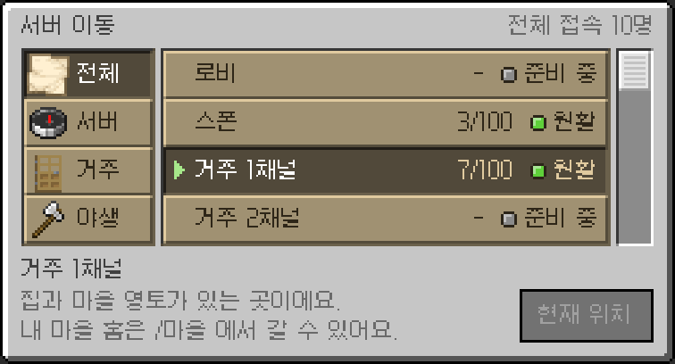
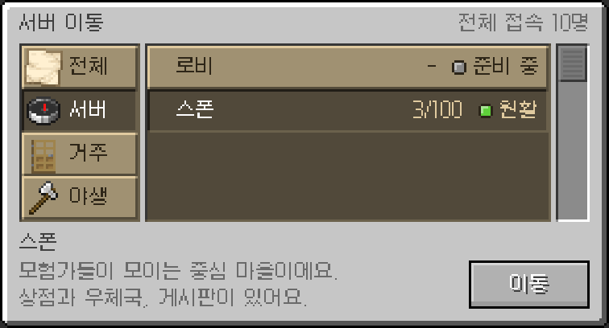
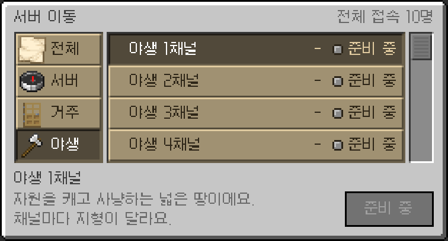

# 서버 이동 화면 (`/coreui travel`)

서버 분류(전체 · 서버 · 거주 · 야생)를 고르고, 그 안의 서버를 골라 이동하는 화면입니다. 도착 지점은 없고 **서버만 옮깁니다**(도착 위치는 그 서버가 정함). 가구 제작대와 같은 **바닐라 컨테이너 스타일**이고, 메인 메뉴의 **이동** 버튼에서도 열립니다.

서버 상태(켜짐·꺼짐, 접속 인원, 최대 인원)와 실제 이동은 **Velocity → Core → UI**로 연결되어 있습니다.

| 전체 (처음 열 때) | 서버(로비·스폰) | 아직 열리지 않은 서버 |
| :---: | :---: | :---: |
|  |  |  |

(미리보기는 프록시에 spawn·home1만 있고 3명·7명, 최대 100명이라고 가정한 그림입니다.)

## 여는 방법

- 메인 메뉴(`/메인메뉴`, Shift+F)의 **이동** 버튼
- `/coreui travel` — 지금은 권한 `coreui.demo`(OP). 메인 메뉴도 `coreui.mainmenu`(OP)라서, 일반 플레이어에게 열려면 권한을 풀어야 합니다.

## 화면 (`menu/travel/TravelMenu`, 252×136)

- **왼쪽 — 분류 4개**: 전체(모든 서버) · 서버(로비·스폰) · 거주 · 야생. 고른 분류는 어두운 색.
- **가운데 — 고른 분류의 서버** (4줄이 보이고, 넘으면 스크롤 막대의 손잡이 위·아래를 눌러 넘김)
  - 한 줄에 이름, 접속 인원(`7/100`), 상태 점과 글자.
  - 상태: `원활`(초록) · `혼잡`(노랑, 최대 인원의 80% 이상) · `포화`(빨강, 최대 인원) · `점검 중`(회색, 서버 꺼짐) · `준비 중`(회색, 프록시에 아직 등록 안 됨) · `확인 중`(회색, 아직 프록시 보고 없음).
  - 지금 있는 서버는 이름 앞에 초록 화살표.
  - 아래 표의 11개 서버는 항상 목록에 나옵니다. 프록시에 등록되지 않은 서버는 `준비 중`이고 이동할 수 없습니다.
- **아래 — 고른 서버**: 이름과 설명 두 줄, `이동` 버튼. 지금 있는 서버면 `현재 위치`, 포화면 `포화`, 꺼져 있으면 `점검 중`, 등록 전이면 `준비 중`으로 바뀌고 눌리지 않습니다.
- 처음 열면 `전체` 탭에서 내가 있는 서버가 골라져 있고, 그 줄이 보이도록 스크롤되어 있습니다.

## 서버 목록 (`menu/travel/TravelCatalog.CATEGORIES`)

어느 서버가 어느 분류인지, 표시 이름과 설명은 코드에 고정되어 있습니다. `전체` 탭은 아래 서버를 모두 같은 순서로 보여 줍니다. **서버 id는 velocity.toml의 서버 이름과 같아야 합니다.**

| 분류 | 서버 id | 표시 이름 |
| --- | --- | --- |
| 서버 | `lobby` | 로비 |
| 서버 | `spawn` | 스폰 |
| 거주 | `home1` ~ `home5` | 거주 1채널 ~ 5채널 |
| 야생 | `wild1` ~ `wild4` | 야생 1채널 ~ 4채널 |

지금 프록시에는 `spawn`, `home1`만 있으므로 나머지 9개는 `준비 중`으로 나옵니다. Velocity에 등록하면 코드 수정 없이 바로 이동할 수 있게 됩니다. 거주는 5개, 전체는 11개라 스크롤됩니다.

## 동작 구조

```
Kokonut-velocity  network/ServerDirectory
  5초마다: 모든 서버 ping(켜짐·최대 인원) + 프록시가 센 접속 인원
  → kokonut:bridge "servers" 메시지로 플레이어가 있는 각 서버에 전송 (받는 서버의 이름 포함)
  ← kokonut:bridge "travel" 메시지(플레이어 UUID, 서버)를 받으면 그 플레이어를 이동,
    실패하면 Core 채팅으로 한국어 안내 (서버 없음, 이미 그 서버, 서버 꺼짐 등)

Kokonut-Core  network/NetworkDirectory  (Bukkit 서비스 api/network/NetworkServers)
  "servers" 메시지를 받아 목록·내 서버 이름을 메모리에 보관 (DB 없음, 조회는 막히지 않음)
  travel(player, server) → "travel" 메시지 전송

Kokonut_UI  menu/kokonut/NetworkBridge → menu/travel/TravelMenu
  화면을 그릴 때 Core 서비스에서 목록을 읽고, 이동 버튼에서 travel 호출
```

- 메시지 형식은 Velocity `ServerDirectory`와 Core `NetworkDirectory`에 적혀 있고, 양쪽 테스트(`ServerDirectoryTest`, `NetworkDirectoryTest`)가 같은 형식을 확인합니다.
- 최대 인원은 각 백엔드 서버의 `server.properties` `max-players`(ping 응답 값)입니다.
- Core나 Velocity가 이전 버전이면 화면은 모든 서버를 `확인 중`으로 보여 주고, 이동은 "서버 이동 기능을 쓸 수 없어요" 또는 아무 반응이 없습니다.

## 배포할 것

- Velocity: `Kokonut-velocity-cbt-1.0-all.jar` → 프록시 plugins (프록시 재시작)
- Core: `Kokonut-Core-cbt-1.0-all.jar` → 모든 백엔드 서버(spawn, home1)
- UI: `Kokonut_UI-cbt-1.0.jar` → 모든 백엔드 서버 + 리소스 팩 다시 만들기

세 JAR 모두 `core/plugin/`에 모여 있습니다.

## 남은 것 / 정할 것

- 일반 플레이어 권한 열기(`coreui.mainmenu`, `/coreui travel`).
- 이동 대기 시간·전투 중 이동 제한 같은 규칙은 없습니다.
- 서버 목록은 플레이어가 있는 서버에만 전달됩니다(플러그인 메시지는 플레이어 연결로만 오가므로). 서버에 들어온 직후 몇 초는 `확인 중`일 수 있습니다.

## 그림

- `tools/dex_glyphs.py`의 `travel_glyphs()` — 배경 패널 `travel/ui/panel_252`, 분류 버튼 `tab`·`tab_on`, 목록 한 줄 `row`·`row_on`, 현재 위치 화살표 `here`, 어두운 스크롤 손잡이 `scroller_off`, 상태 점 `dot_smooth|busy|full|down`.
- 칸·버튼·스크롤 손잡이는 가구 제작대의 `furniture/ui/*`를 같이 씁니다. 공통 그리기 코드는 `menu/vanilla/VanillaCanvas`.

미리보기: `java -cp "build/classes/java/main;build/resources/main;<컴파일 클래스패스>" tools/MenuPreview.java "%APPDATA%/.minecraft/versions/26.3/26.3.jar" docs/shop-preview travel`
