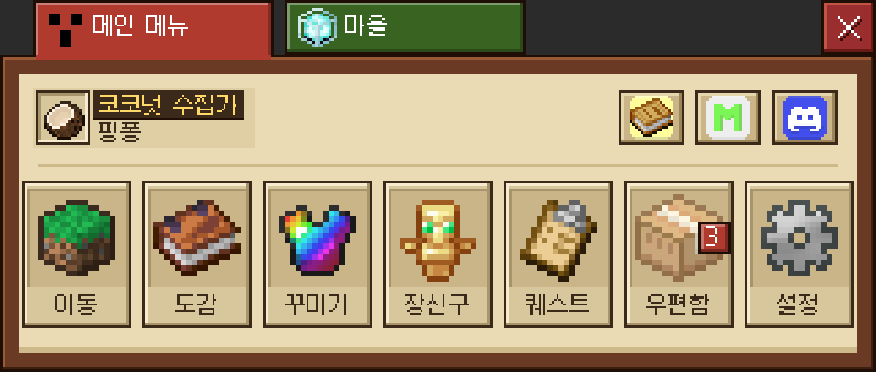
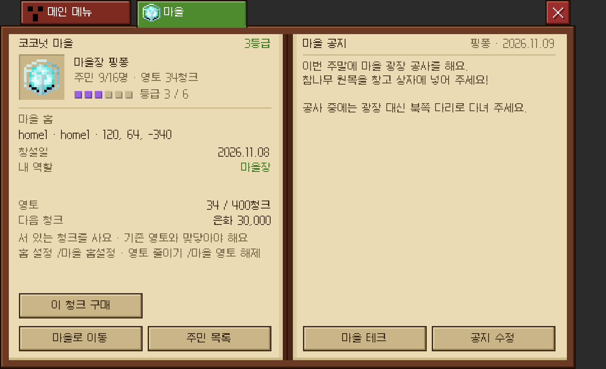
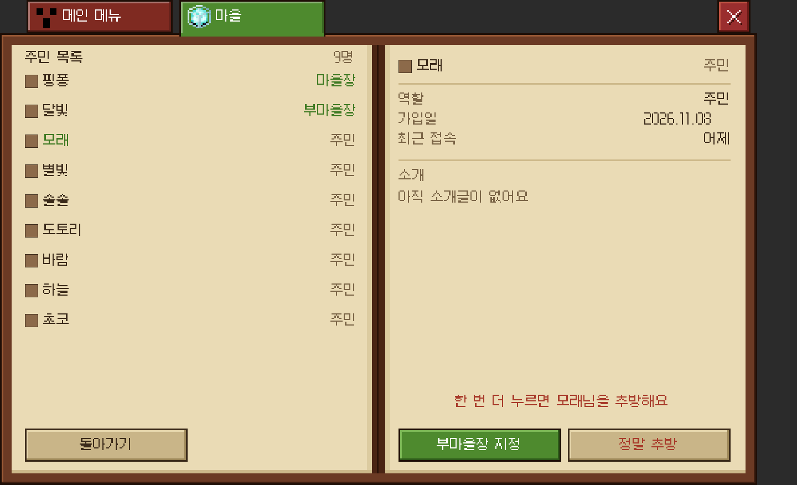
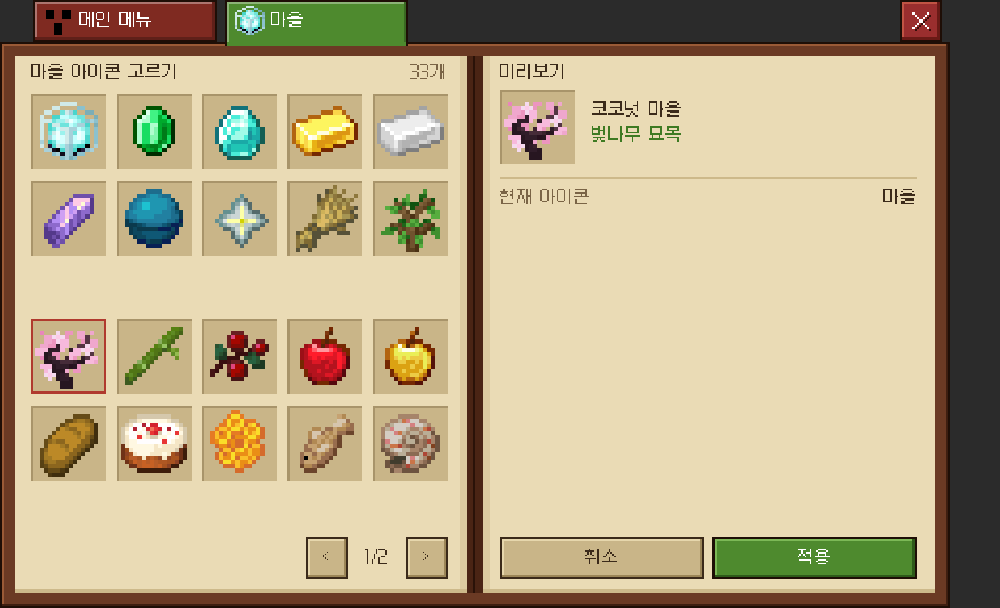
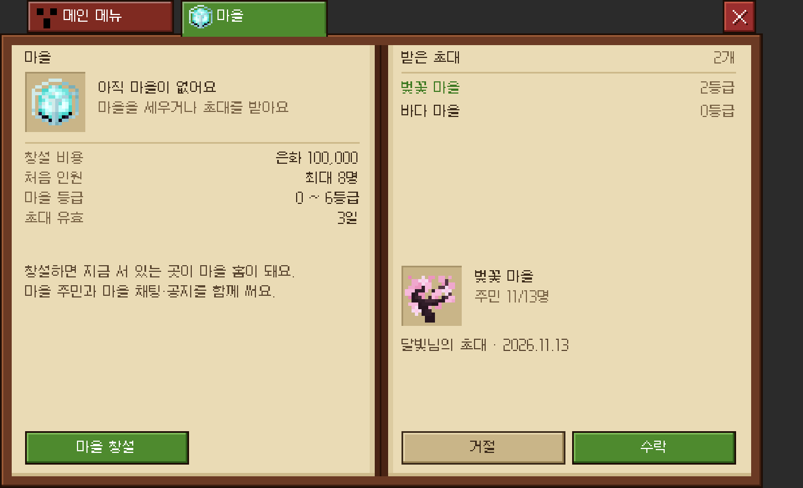

# 마을(길드) 화면 (메인 메뉴 → 초록 마을 탭, `/마을`)

메인 메뉴의 빨간 "메인 메뉴" 탭 오른쪽에 **초록 마을 탭**(`menu/ui/tab_green_off`, 마을 아이콘 `vil.png`)이 있습니다. 누르거나 `/마을`을 입력하면 마을 화면(`menu/village/VillageMenu`)이 열립니다.
마을 화면의 탭 줄은 "메인 메뉴"(빨강 비활성, 누르면 돌아감)와 "마을"(초록 활성, 책과 이어짐)입니다.

| 메인 메뉴 | 마을 | 주민 목록 · 추방 확인 | 마을 아이콘 고르기 | 마을 없음 · 받은 초대 |
| :---: | :---: | :---: | :---: | :---: |
|  |  |  |  |  |

미리보기의 갈색 네모는 8px 머리 자리입니다. 머리는 게임 클라이언트가 스킨으로 직접 그립니다.
미리보기는 `tools/MenuPreview.java`가 `VillageStore.sample(...)` 샘플 데이터로 그립니다.

## 데이터 흐름

- 데이터와 모든 변경은 Kokonut-Core `VillageService`(`kr.gomsv.kokonutCore.api.village`)를 거칩니다. Core 클래스를 부르는 곳은 `VillageBridge` 하나뿐이고, `VillageMenu`·`VillageStore`는 Core 없이도 로드됩니다.
- 화면을 열 때 한 번 불러온 스냅숏으로 화면 사이를 오가고, 바꾸는 동작(수락·추방·공지 등) 뒤에는 다시 불러옵니다.
- 권한은 Core가 다시 확인합니다. 화면은 버튼을 숨기기만 합니다. 결과 문장은 Core가 보낸 것을 그대로 채팅에 보여 줍니다.
- `CoreViews`가 이 화면을 Core의 `VillageView`로 등록해서 `/마을`이 화면을 엽니다. Core가 없거나 오래된 버전이면 탭은 "마을 화면을 아직 불러오지 못했어요"라고 안내합니다.

## 규칙 (Core `VillageRules`)

- 마을: 이름, **등급 0~6**, 마을장, 생성일, 홈(서버·월드·좌표), 아이콘, 공지, 기술 포인트.
- 역할: `OWNER`(마을장) 전부 / `OFFICER`(부마을장) 초대·주민 추방·공지·영토 구매/해제 / `MEMBER`(주민) 자기 소개글·탈퇴. 한 플레이어는 한 마을에만 속합니다.
- 창설 비용 은화 100,000, 최대 인원은 등급별 8·10·13·16·20·25·30명, 초대는 3일 유효.

## 화면

- **마을 없음** (`View.NONE`):
  - 왼쪽: 창설 비용·처음 인원·등급·초대 유효 안내와 `마을 창설`(이름 입력창, 12자).
  - 오른쪽: 받은 초대 목록(최대 6개). 고른 초대의 아이콘·인원·초대한 사람·날짜와 `거절` / `수락`. 인원이 가득 찬 마을은 수락이 꺼집니다.
- **마을 메인**:
  - 왼쪽: 이름·등급, 32px 아이콘 칸(마을장이 누르면 아이콘 고르기), 마을장, 주민 `현재/최대`·영토, 등급 핍, 마을 홈, 창설일, 내 역할.
    영토 `현재/400청크`와 다음 청크 가격(무료·은화·더 넓힐 수 없음).
    마을장·부마을장에게는 `이 청크 구매`(서 있는 청크, 한 번 더 눌러야 실행)와 영토 줄이기(마을장은 홈 설정도) 명령 안내가 보입니다.
    버튼은 `마을로 이동`(홈이 없으면 꺼짐, 누르면 화면을 닫고 이동) / `주민 목록`.
  - 오른쪽: 마을 공지(작성자·날짜, 자동 줄바꿈, 16줄). `마을 테크`(추후) / `공지 수정`(마을장·부마을장, 여러 줄 12줄·400자, 비우면 삭제).
- **주민 목록**:
  - 왼쪽: 8px 머리·닉네임·역할을 11명씩(마을장 → 부마을장 → 가입일 순). 아래 `돌아가기`, 마을장·부마을장에게 `초대`(닉네임 입력창, 인원이 차면 "가득 참").
  - 오른쪽: 고른 주민의 역할·가입일·최근 접속(이 서버에 있으면 "접속 중")과 소개글.
    - 본인: `소개 수정`(6줄·200자), `마을 탈퇴`(한 번 더 눌러야 실행). 마을장은 탈퇴 불가 — `/마을 위임`·`/마을 해산` 안내.
    - 마을장 → 다른 주민: `부마을장 지정`/`해제`, `추방`(한 번 더). 부마을장 → 주민: `추방`.
- **마을 아이콘 고르기**: 33개 아이콘(5×4, 32px), 미리보기, `취소` / `적용`(마을장).

## 글리프

- `menu/ui/tab_green`, `tab_green_join`, `tab_green_off`: 초록 마을 탭 / `menu/ui/tab_off`: 빨강 비활성 탭
- `menu/icon/vil`, `vil_32`: `D:/kokonut/resource/vil.png`(→ `art/icons/vil.png`)
- `menu/ui/well_selected`: 선택된 아이콘 칸 / `village/icon/<아이템>`: 바닐라 아이템 32px(`tools/dex_vanilla.txt`의 `village/icon/*`, `VanillaGlyphs.java`)
- 버튼: `dex/ui/btn_paper_52`(돌아가기·초대) 외 기존 98px 버튼

## 아직 없는 것

- 마을 테크 화면, 등급 승급 조건, 영토 지도(어느 청크가 영토인지 화면에서 보기).
- 위임·해산·홈 설정은 명령으로만 합니다(`/마을 위임 <닉네임> 확인`, `/마을 해산 확인`, `/마을 홈설정`).
- "접속 중"은 같은 서버에 있는 주민만 표시합니다. 다른 서버 주민은 최근 접속 시각(접속·퇴장 때 기록)으로 나옵니다.
