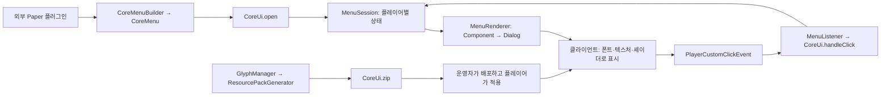
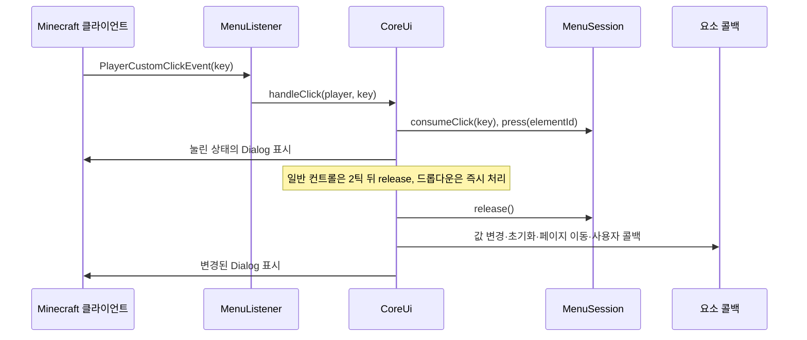

# CoreUi 프로젝트 구조와 작동 원리

이 프로젝트는 Minecraft Paper 플러그인에서 Ore UI 스타일의 메뉴를 만들기 위한 Java 라이브러리이자 서버 플러그인이다. 외부 플러그인은 빌더로 메뉴와 콜백을 정의하고, CoreUi는 플레이어별 상태 관리, 화면 생성, 클릭 처리, 리소스팩 생성을 담당한다.

핵심은 **Paper Dialog에 Adventure 텍스트 컴포넌트를 보내고, 리소스팩의 특수 폰트와 셰이더로 이를 UI처럼 그리는 방식**이다. 버튼이나 슬라이더의 외형은 문자에 연결된 이미지와 셰이더로 표현하며, 사용자 입력은 텍스트의 custom click 이벤트로 서버에 전달한다.

분석 기준은 [README.md](README.md), Java 소스, Gradle 설정, 내장 리소스팩이다. 아래 실행 흐름은 정적 코드 분석 결과이며, 실제 Paper 서버 실행이나 버전별 클라이언트 렌더링 검증은 수행하지 않았다.

## 1. 전체 구성



구성은 세 부분으로 나뉜다.

- **메뉴 정의**: `CoreMenuBuilder`, `CoreMenu`, `MenuElement`가 메뉴의 배치와 동작을 표현한다.
- **서버 실행**: `CoreUi`, `MenuSession`, `MenuRenderer`, `MenuListener`가 플레이어별 상태와 입력을 처리한다.
- **클라이언트 표현**: 리소스팩의 폰트·텍스처·GLSL 셰이더가 서버에서 보낸 문자를 실제 UI로 표시한다.

## 2. 디렉터리와 주요 클래스

```text
.
├─ README.md                         사용법, 예제, 리소스팩 안내
├─ build.gradle.kts                  의존성, Java 설정, JAR 생성, 개발 서버
├─ settings.gradle.kts               프로젝트 이름: CoreUi
├─ gradle.properties                 그룹, 버전, Gradle 옵션
├─ gradle/wrapper/                   Gradle Wrapper
├─ jitpack.yml                       JitPack 빌드 설정
└─ src/main/
   ├─ java/org/crebs/coreui/
   │  ├─ CoreUi.java                 플러그인 진입점과 공개 API
   │  ├─ menu/
   │  │  ├─ CoreMenu.java             완성된 메뉴 정의
   │  │  ├─ CoreMenuBuilder.java      메뉴·요소 빌더와 구성 검증
   │  │  ├─ Metrics.java              컨트롤 배치에 쓰는 공통 수치
   │  │  ├─ demo/                     기본 컨트롤을 확인하는 내장 데모 메뉴
   │  │  ├─ element/                  버튼·토글·슬라이더 등 요소 모델
   │  │  ├─ listener/                 Paper 이벤트 연결
   │  │  ├─ render/                   Dialog 생성, 좌표·스타일 인코딩
   │  │  ├─ session/                  값, 페이지, 포커스, 클릭, 애니메이션 상태
   │  │  └─ style/                    테마와 버튼 스타일
   │  ├─ glyph/                      커스텀 이미지 글리프와 레지스트리
   │  └─ pack/
   │     ├─ ResourcePackGenerator.java
   │     └─ unicode/                 폰트 provider JSON 모델과 보조 클래스
   └─ resources/
      ├─ plugin.yml                  플러그인·명령어·권한 등록
      └─ resource-pack/
         ├─ pack.mcmeta              팩 포맷과 버전별 overlay 선택 범위
         ├─ assets/coreui/            공통 폰트, 글리프 텍스처, GLSL include
         ├─ assets/minecraft/         Dialog 관련 텍스처
         ├─ coreui_1_21_11/           1.21.11용 셰이더
         ├─ coreui_26_1/              26.1.x용 셰이더
         ├─ coreui_26_2/              26.2.x용 셰이더
         └─ coreui_26_3/              26.3용 셰이더
```

| 주요 코드 | 책임 |
| --- | --- |
| [CoreUi](src/main/java/org/crebs/coreui/CoreUi.java) | 서버 생명주기, 플레이어 세션, 공개 메뉴 API, 클릭 실행, 값 보관 |
| [CoreMenuBuilder](src/main/java/org/crebs/coreui/menu/CoreMenuBuilder.java) / [CoreMenu](src/main/java/org/crebs/coreui/menu/CoreMenu.java) | 빌더로 정의를 모으고 검증한 뒤, 요소 목록을 복사해 메뉴 객체 생성 |
| [MenuElement](src/main/java/org/crebs/coreui/menu/element/MenuElement.java) | 공통 속성과 페이지별 표시 규칙을 제공하는 sealed interface |
| [MenuSession](src/main/java/org/crebs/coreui/menu/session/MenuSession.java) | 하나의 열린 메뉴에 대한 상태와 클릭 키 → 콜백 매핑 관리 |
| [MenuRenderer](src/main/java/org/crebs/coreui/menu/render/MenuRenderer.java) | 세션을 읽어 텍스트 캔버스, 클릭 영역, 최종 Dialog 생성 |
| [MenuListener](src/main/java/org/crebs/coreui/menu/listener/MenuListener.java) | custom click과 접속 종료 이벤트를 CoreUi에 전달 |
| [GlyphManager](src/main/java/org/crebs/coreui/glyph/GlyphManager.java) / [Glyph](src/main/java/org/crebs/coreui/glyph/Glyph.java) | 로드된 이미지 글리프 조회, 비동기 재생성, 폰트가 지정된 Component 생성 |
| [ResourcePackGenerator](src/main/java/org/crebs/coreui/pack/ResourcePackGenerator.java) | JAR 내부 리소스와 사용자 PNG를 합쳐 ZIP 생성 |

## 3. 서버 시작부터 메뉴 종료까지

### 서버 시작

`plugin.yml`은 `org.crebs.coreui.CoreUi`를 진입점으로 등록하며, 로드 시점은 `POSTWORLD`다. `onEnable()`은 다음 작업을 수행한다.

1. 플러그인 데이터 폴더와 자기 JAR 경로로 `GlyphManager`를 생성한다.
2. `reloadPack()`으로 리소스팩 생성을 비동기로 시작한다. 완료까지 기다리지 않고 플러그인 초기화를 계속한다.
3. `MenuListener`, `/coreui demo [light|dark]`, `/coreui reload` 명령어를 등록한다. 인자 없는 `/coreui`도 데모를 연다.
4. 200틱마다 실행되는 세션 만료 정리 작업을 등록한다.

시작 직후에는 커스텀 글리프 레지스트리가 아직 비어 있을 수 있다. 글리프를 사용하는 메뉴는 팩 생성 완료 뒤 구성해야 한다. 내장 데모 명령어는 예제 글리프가 준비되었는지 확인한 뒤 메뉴를 연다.

### 기본 UI 확인

OP 플레이어가 `/coreui` 또는 `/coreui demo`를 실행하면 `DemoMenu`가 버튼·토글·체크박스·슬라이더·테마 드롭다운·진행률·배지·이미지를 포함한 메뉴를 만든다. `/coreui demo light`와 `/coreui demo dark`로 시작 테마를 선택할 수 있으며, 권한은 `coreui.demo`다. 데모는 열 때마다 초기값으로 시작한다.

팩 생성 시 내장 화살표 이미지를 `Glyphs/example-arrow.png`로 설치하므로 빈 설치에도 예제 이미지 글리프 1개가 등록된다. 이미 존재하는 동명의 파일은 덮어쓰지 않는다. 생성된 `CoreUi.zip`을 클라이언트 리소스팩 폴더에 넣고 활성화한 뒤 데모를 열면 된다.

### 메뉴 열기와 갱신

외부 플러그인이 `coreUi.open(player, menu)`를 호출하면 다음 순서로 진행된다.

1. 서버 메인 스레드인지 확인한다.
2. 기존 메뉴가 `rememberValues()`를 사용했다면 현재 값을 보관한다.
3. 새 메뉴의 ID에 해당하는 저장값을 찾는다. 값 기억을 사용하지 않는 메뉴는 초기값으로 시작한다.
4. `MenuSession`을 생성해 플레이어 UUID에 연결한다.
5. `MenuRenderer.render(session, worldGameTime)`으로 Dialog를 만든다.
6. `player.showDialog(...)`로 화면을 표시한다.

`refresh(player)`는 활동 시각을 갱신하고 현재 세션 전체를 다시 그린다. `navigate(player, page)`와 `focus(player, elementId)`도 상태를 바꾼 뒤 `refresh()`를 호출한다. 페이지 이동은 같은 메뉴 안에서 표시할 요소를 바꾸는 방식이다.

### 종료와 정리

- `close(player)`: 값을 보관하고 서버 세션을 제거한 뒤, 클라이언트 Dialog를 닫는다.
- `removeSession(player)`: 값 보관과 서버 세션 제거를 수행한다. 접속 종료 이벤트에서 사용한다.
- 세션의 마지막 활동 이후 **600,000ms, 즉 10분**이 지나면 만료된다. 주기적 검사와 클릭 처리 시 만료 여부를 확인한다. `refresh()`도 활동으로 취급한다.
- `onDisable()`은 열린 메뉴를 닫고 세션·저장값·테마 맵을 비운다.

## 4. 메뉴 정의와 요소 모델

`CoreMenu`에는 메뉴 ID, 제목, 선택적 헤더, 기본 페이지, 테마, 크기, 값 기억 여부, 요소 목록이 들어 있다. `CoreMenuBuilder`의 요소별 빌더에서 `.add()`를 호출하면 요소가 추가되고, 마지막 `.build()`가 메뉴 전체를 검증한다.

각 요소는 `ElementProperties`를 통해 ID, `Bounds(x, y, width, height)`, 페이지, 라벨, 설명을 공유한다. 위치는 메뉴 본문 왼쪽 위를 기준으로 지정한다. 기본 페이지는 `main`이고, 요소에 `.page("*")`를 지정하면 모든 페이지에 표시된다.

| 빌더 / 요소 | 표현과 동작 |
| --- | --- |
| `label()` / `LabelElement` | 텍스트 표시 |
| `panel()` / `PanelElement` | 배경 패널 표시. 다른 요소보다 먼저 그림 |
| `button()` / `ButtonElement` | 클릭 콜백, 값 초기화, 페이지 이동. `DEFAULT`, `PRIMARY`, `TAB` 스타일 지원 |
| `tab()` | 대상 페이지를 가진 compact 버튼 구성 |
| `toggle()`, `checkbox()` / `ToggleElement` | boolean 값과 변경 콜백. 체크박스는 같은 모델의 표현 옵션 |
| `slider()` / `SliderElement` | 정수 범위·간격·초기값과 변경 콜백 |
| `dropdown()` / `DropdownElement` | 선택지 Component 목록과 선택 인덱스, 변경 콜백 |
| `badge()`, `progress()`, `divider()` / `DisplayElement` | 배지, 0~1 진행률, 구분선 표시 |
| `glyph()` / `GlyphElement` | 커스텀 PNG를 폰트 글리프로 표시 |

빌더와 요소 생성자는 잘못된 구성을 화면을 열기 전에 거부한다.

- 제목과 테마는 필수이며, 요소 ID는 메뉴 안에서 중복될 수 없다.
- 기본 메뉴 크기는 `300×240`, 허용 범위는 너비 `140~480`, 높이 `90~320`이다.
- 요소 좌표는 음수일 수 없고, 요소는 메뉴 크기 안에 들어와야 한다. 헤더를 사용하면 본문 위에 24픽셀이 추가된다.
- 일반 버튼 행·토글·슬라이더·드롭다운은 높이 33, 너비 `190~470`이다. compact 버튼은 높이 24, 너비 `60~470`이다.
- 슬라이더 범위는 간격으로 나누어떨어져야 하고, 초기값도 해당 간격에 맞아야 한다. 구간 수는 트랙에서 구별할 수 있는 픽셀 수를 넘을 수 없다.
- 드롭다운은 서로 다른 선택지 `1~8`개를 받으며, 펼친 목록까지 메뉴 높이 안에 들어와야 한다.
- 버튼의 이동 대상 페이지와 초기화 대상 컨트롤이 실제로 존재하는지 검사한다.

문자열 형태의 `title`, `header`, `label`, `description`, `indicatorLabel`은 MiniMessage로 파싱한다. `Component.text(...)`로 전달한 내용은 그대로 사용한다.

## 5. 텍스트로 UI를 그리는 원리

### 5.1 Dialog를 캔버스로 사용

`MenuRenderer.render()`는 Paper `Dialog`의 본문에 `DialogBody.plainMessage(canvas, 511)`을 넣는다. custom click 후에는 화면을 자동으로 닫지 않도록 `DialogAfterAction.NONE`을 사용하며, Escape 종료도 허용한다.

렌더러는 가로 480픽셀의 논리 캔버스를 기준으로 메뉴를 가운데 배치한다. 요소의 실제 가로 위치는 `(480 - 메뉴 너비) / 2 + x`로 계산한다. 세로 위치는 텍스트 줄의 9픽셀 간격을 기준으로 `y / 9`와 `y % 9`로 나눈다.

`coreui:space` 폰트의 `U+E100`은 가로로 +1, `U+E101`은 -1만큼 이동한다. 요소를 그릴 위치까지 공백 문자로 이동하고, 그린 뒤 음수 공백으로 커서를 되돌리는 방식으로 같은 줄에 여러 요소를 겹쳐 배치한다.

기본 Dialog 제목 영역에는 긴 공백 컴포넌트를 사용하고, 메뉴 제목은 `externalTitle`로 설정한다. 눈에 보이는 헤더는 별도로 그린다. 버전별 `gui.fsh`에는 기본 Dialog 테두리의 특정 크기·색 패턴을 찾아 숨기는 처리도 포함되어 있다.

### 5.2 폰트와 이미지의 역할

| 폰트 | 역할 |
| --- | --- |
| `coreui:glyphs` | 기본 문자, 버튼·패널 등 UI 이미지, 클릭 영역용 글리프 |
| `coreui:space` | 가로 커서 위치 조절 |
| `coreui:bounds`, `coreui:bounds_overlay` | 텍스트 줄과 overlay 배치의 기준이 되는 경계 글리프 |
| `coreui:overlay` | 포커스 테두리와 드롭다운 팝업을 상위 레이어에 표시 |
| `coreui:custom/<id>` | 사용자가 추가한 PNG 이미지별 전용 폰트 |

`MenuSkin.glyph()`는 enum 순서를 `U+E300 + ordinal()`에 연결한다. 이 문자와 폰트 JSON, 대응 텍스처가 함께 하나의 스킨을 결정하므로 enum 순서와 리소스의 문자 매핑을 함께 관리해야 한다.

### 5.3 ShadowColor를 렌더링 데이터로 활용

일반 텍스트의 그림자 색을 지정하는 `ShadowColor`에 UI 렌더링용 숫자를 넣는다. 리소스팩 셰이더는 텍스처의 표식 픽셀과 색상 값을 확인해 CoreUi 데이터인지 판단하고, 해당 값을 해석한다.

| 대상 | 서버가 넣는 데이터 | 클라이언트 처리 |
| --- | --- | --- |
| 패널·버튼 같은 사각형 | 너비, 높이, 줄 내부 세로 오프셋 | 작은 글리프의 정점을 원하는 크기로 확장 |
| 일반 라벨 | `TextPosition`의 표식 색 `0xFCFDEF`, 그림자 RGB의 실제 글자색, alpha의 세로 오프셋 | 표식용 원본을 숨기고 원하는 색과 위치로 표시 |
| 토글·슬라이더 손잡이 | 상태, 시작 틱, 이동 거리, 세로 오프셋 | 게임 시간에 따라 손잡이 위치 보간 |
| 드롭다운 팝업 | 시작 틱, 열림·닫힘 방향, 시작 진행률, 위치·너비 | 이동과 투명도 애니메이션 계산 |

공통 셰이더 파일의 역할은 다음과 같다.

- [stretch_quads.glsl](src/main/resources/resource-pack/assets/coreui/shaders/include/stretch_quads.glsl): 표식과 인코딩을 해석해 사각형 크기·위치·애니메이션을 계산한다.
- [quad_paint.glsl](src/main/resources/resource-pack/assets/coreui/shaders/include/quad_paint.glsl): 늘어난 사각형에 텍스처를 입힌다. 테두리를 유지하며 내부를 늘리는 방식으로 패널과 버튼을 표현한다.
- [position_marker.glsl](src/main/resources/resource-pack/assets/coreui/shaders/include/position_marker.glsl): 위치 지정용 텍스처 표식을 확인하고 표시 색상으로 변환한다.

따라서 Java 렌더러의 인코딩 규칙, 폰트 매핑, 텍스처 표식, 셰이더의 디코딩 규칙이 서로 맞아야 화면이 정상적으로 나온다.

### 5.4 그리는 순서와 클릭 영역

한 번의 렌더링은 기존 클릭 키를 지운 뒤 다음 순서로 진행된다.

1. 헤더와 전체 메뉴 배경을 그린다.
2. 현재 페이지와 공통 페이지의 요소를 고른다.
3. 하위 패널을 먼저 그리고, 나머지 요소의 텍스트·컨트롤을 그린다.
4. overlay에 포커스 테두리와 드롭다운 선택지 목록을 그린다.
5. 클릭 영역을 추가하고 줄별 Component를 최종 본문으로 합친다.

클릭 영역에는 거의 투명한 bitmap 글리프를 사용한다. 각 사각형을 높이 최대 9픽셀 조각으로 나누고, 너비를 1·2·4·8 등의 글리프로 채운 뒤 `ClickEvent.custom(key, "{}")`를 붙인다. 클라이언트는 이 텍스트 영역을 클릭해 식별 키를 보낸다.

드롭다운이 열리면 `subtract()`가 목록에 가려진 기존 요소의 클릭 영역을 잘라낸다. 겹치는 라벨의 클릭도 제거해 팝업 뒤의 컨트롤이 입력을 받는 것을 막는다.

### 5.5 애니메이션

토글·슬라이더의 손잡이는 `Motion`에 이동 거리와 시작 틱을 저장하고, 드롭다운은 `PopupAnimation`에 열림·닫힘 상태와 진행률을 저장한다. 렌더러는 월드의 `getGameTime()`을 사용하고, 셰이더는 24,000틱 주기로 환산한 `GameTime`으로 경과 시간을 계산한다.

손잡이 이동과 팝업 전환은 4틱을 기준으로 보간한다. 상태 변경 시 애니메이션 정보를 보낸 뒤 중간 프레임은 클라이언트 셰이더가 계산한다. 서버의 200틱 타이머는 세션 정리용이며, 화면 애니메이션을 매 틱 재전송하는 용도로 사용하지 않는다.

## 6. 클릭에서 콜백까지



렌더링 중 `registerClick()`은 `coreui:click/<랜덤 UUID>` 형태의 키를 만들고, 현재 `MenuSession`에 요소 ID·세부 영역·콜백을 저장한다. 서버는 마우스 좌표를 직접 받아 요소를 찾는 대신, 이 키를 조회해 실행할 동작을 결정한다.

`MenuListener`는 `coreui` namespace와 플레이 중인 연결만 처리한다. 이벤트가 비동기로 들어오면 Bukkit 스케줄러를 통해 메인 스레드로 전달한다. 이후 `CoreUi`는 세션 존재 여부, 만료, 닫기 키, 이미 눌림 처리 중인지 확인한다.

유효한 키를 소비하면 그 키와 같은 화면의 나머지 클릭 키를 모두 지운다. 다시 그릴 때 새 키가 생성되므로 이전 화면의 키를 재사용한 입력은 무시된다. 일반 컨트롤은 눌린 화면을 먼저 표시한 뒤 2틱 후 콜백을 실행하고, 드롭다운은 바로 release 경로를 실행한다.

요소별 콜백은 다음과 같이 동작한다.

- **버튼**: 지정한 값을 초기화하고 변경된 컨트롤의 `onChange`를 호출한 뒤, 대상 페이지로 이동하고 버튼 `onClick`을 실행한다.
- **토글·체크박스**: 세션의 boolean 값을 뒤집고 `onChange(player, value)`를 호출한다.
- **슬라이더**: 각 값에 대응하는 클릭 구간을 미리 생성한다. 클릭한 구간의 값을 `snap()`으로 보정해 저장하고 `onChange`를 호출한다. 구현상 입력은 단계별 클릭 구간으로 처리한다.
- **드롭다운**: 본체 클릭으로 목록을 열거나 닫고, 선택지 클릭으로 인덱스를 저장한 뒤 목록을 닫고 `onChange`를 호출한다.

release 시 플레이어가 온라인이고 같은 세션이 열려 있는지 다시 확인한다. 사용자 콜백에서 다른 메뉴를 열었다면 이전 세션을 다시 그리지 않는다. 콜백에서 `RuntimeException`이 발생하면 오류를 기록하고, 해당 세션이 여전히 활성 상태일 때 메뉴를 닫는다.

## 7. 상태와 값 기억

메뉴 정의와 플레이어별 실행 상태를 분리한다. 하나의 `CoreMenu`를 여러 플레이어에게 열어도 값·페이지·포커스·클릭 키는 각자의 `MenuSession`에서 관리된다.

| 저장 위치 | 내용과 수명 |
| --- | --- |
| `CoreMenu` | 배치, 초기값, 옵션, 콜백 등 메뉴 정의 |
| `MenuSession` | 열린 동안의 값, 활성 페이지, 테마, 포커스, 눌림, 팝업·이동 상태, 클릭 키 |
| `CoreUi.rememberedValues` | 플레이어 UUID → 메뉴 ID → `MenuValues` 스냅샷 |
| `MenuValues` | 토글 boolean, 슬라이더 정수, 드롭다운의 선택된 Component |

`.rememberValues()`를 사용하면 메뉴 교체·닫기·접속 종료 등에서 값을 보관하고, 같은 플레이어가 같은 메뉴 ID를 다시 열 때 복구한다. 플레이어의 접속 종료 후에도 메모리의 저장값은 남지만, 서버 재시작이나 플러그인 비활성화 시 사라진다. DB나 파일에 영속 저장하는 코드는 없다.

슬라이더 저장값이 새 범위·간격에 맞지 않으면 초기값으로 돌아간다. 드롭다운은 인덱스 대신 선택된 Component를 보관하고, 다시 열 때 새 옵션 목록에서 같은 Component를 찾아 인덱스를 복구한다. 옵션 순서가 바뀌어도 같은 항목이 있으면 선택을 유지하며, 항목이 없어지면 초기값을 사용한다.

`.resetValues("id1", "id2")`는 지정한 컨트롤을 정의상의 초기값으로 돌린다. 버튼 경로에서는 실제로 값이 달라진 컨트롤의 변경 콜백만 호출한다. 세션의 `resetValues()` 자체는 변경된 요소 목록을 반환하며 사용자 콜백을 직접 실행하지 않는다.

## 8. 리소스팩 생성과 커스텀 이미지

### 8.1 생성 파이프라인

시작 시와 `/coreui reload` 실행 시 다음 작업을 수행한다.

1. `plugins/CoreUi/Glyphs`, `plugins/CoreUi/Pack` 디렉터리를 준비한다. `glyphs.yml`이 없으면 기본 파일을 만든다.
2. `glyphs.yml`을 읽고 새 Packer `ResourcePack`을 생성한다.
3. 자기 JAR의 `resource-pack/` 아래 파일을 팩 루트로 복사한다.
4. 내장 `arrow_up.png`를 `Glyphs/example-arrow.png`로 설치한다. 해당 파일이 이미 존재하면 그대로 유지한다. `Glyphs`를 재귀 탐색해 `.png` 파일을 읽고 이름·이미지·표시 크기를 검증한다.
5. 사용자 텍스처와 이미지별 폰트 JSON, 새 `Glyph` 레지스트리를 구성한다.
6. 임시 ZIP을 완성한 후 `Pack/CoreUi.zip`으로 교체한다. atomic move를 우선 사용하고 지원되지 않으면 일반 교체를 사용한다.
7. 생성기가 성공 결과를 반환하면 `GlyphManager`가 새 레지스트리를 공개하고 Future를 완료한다.

`GlyphManager.reload()`는 `CompletableFuture.supplyAsync()`로 작업을 실행한다. `AtomicBoolean`으로 중복 재생성을 막고, 새 레지스트리는 불변 맵을 `volatile` 필드에 대입해 공개한다. 생성 실패 시 이전 레지스트리는 교체하지 않는다. 임시 ZIP을 사용해 완성되기 전의 파일로 기존 팩을 덮어쓰지 않도록 구성되어 있다.

`reloadPack()`의 반환형은 `CompletableFuture<Path>`이며, 완료 시 ZIP 경로를 얻는다. 완료 콜백에서 메뉴를 열거나 갱신하려면 서버 메인 스레드로 전환해야 한다. `/coreui reload`는 이 전환 후 결과 메시지를 전송한다. 권한은 `coreui.reload`이고 기본 부여 대상은 OP다.

### 8.2 PNG를 글리프로 바꾸는 방식

`Glyphs/icons/coin.png`는 ID `icons/coin`이 되고 다음 리소스를 생성한다.

```text
assets/coreui/textures/custom/icons/coin.png
assets/coreui/font/custom/icons/coin.json
font key: coreui:custom/icons/coin
```

- ID에는 소문자 영문, 숫자, `_`, `-`, `/`를 사용할 수 있다.
- `height`는 표시 높이로 `1~256`, `ascent`는 기준선 정렬값으로 `-256~height`다. 기본값은 이미지 높이와 그 표시 높이다.
- 표시 너비는 이미지 종횡비와 표시 높이로 계산한다. 커서 이동량 `advance`는 오른쪽의 마지막 불투명 픽셀을 기준으로 따로 계산한다.
- 이미지마다 전용 폰트를 만들고 `U+E000~U+E008`을 서로 다른 ascent로 등록한다. 이를 통해 텍스트의 9픽셀 줄 간격 안에서 이미지 위치를 세밀하게 조절한다.
- `Glyph.component()`는 글리프를 채팅·액션바 등에 넣을 Component를 만들고, `builder.glyph(...).position(...).add()`는 메뉴 이미지 요소를 만든다.

폰트가 ID별로 분리되어 있으므로 다른 이미지를 추가해도 기존 글리프 ID가 밀리지 않는다. 이미지 크기 설정을 바꾼 뒤에는 레지스트리에서 글리프를 다시 얻고 메뉴도 다시 만들어야 새 치수가 반영된다.

### 8.3 버전별 overlay와 폰트 보조 코드

한 ZIP 안에 공통 리소스와 버전별 셰이더를 함께 넣고, [pack.mcmeta](src/main/resources/resource-pack/pack.mcmeta)의 포맷 범위로 클라이언트가 overlay를 선택하게 한다.

| 디렉터리 | README의 대상 버전 | 선언된 팩 포맷 범위 | 텍스트 셰이더 |
| --- | --- | --- | --- |
| `coreui_1_21_11` | 1.21.11 | 75~83 | `rendertype_text.vsh/fsh` |
| `coreui_26_1` | 26.1.x | 84~87 | `rendertype_text.vsh/fsh` |
| `coreui_26_2` | 26.2.x | 88~96 | `text.vsh/fsh` |
| `coreui_26_3` | 26.3 | 97~`[97, 1]` | `text.vsh/fsh` |

`pack/unicode`에는 bitmap, space, reference, TTF, unihex provider를 JSON으로 표현하는 보조 모델이 있다. 현재 `ResourcePackGenerator.generate()`의 사용자 글리프 경로는 이 모델을 사용하지 않고 `Map`과 Gson으로 폰트 JSON을 직접 만든다.

## 9. 빌드와 설치 구조

| 항목 | 저장소 설정 |
| --- | --- |
| 프로젝트 / 버전 | `CoreUi` / `gradle.properties`의 `1.0` |
| Gradle Wrapper | `9.8.0` |
| 빌드 JDK | Java toolchain `25`, JitPack도 `openjdk25` |
| Java 컴파일 대상 | `options.release = 25` |
| Paper 컴파일 의존성 | `paper-api:26.3.build.243-stable`, `compileOnly` |
| 리소스팩 생성 의존성 | `com.github.DRAGNIL68:Packer:d7bb7af0cf`, `implementation` |
| 개발 서버 | `run-paper` 플러그인, Minecraft `26.3`, 힙 `2G` |

현재 테스트 빌드는 Paper API `26.3.build.243-stable`과 `plugin.yml`의 `api-version: '26.3'`을 사용하며 README의 요구사항도 Paper 26.3 / Java 25 이상으로 맞췄다. **Paper 26.3 API의 Java 25 요구사항에 맞춰 빌드 도구체인과 컴파일 대상을 모두 Java 25로 설정했다. 테스트 서버도 Java 25 이상이 필요하다.** README의 소비자 의존성 예제 태그 `1.0.0`과 저장소의 Gradle 버전 `1.0`도 구분해서 읽어야 한다.

Windows PowerShell에서 사용하는 명령은 다음과 같다.

```powershell
.\gradlew.bat build
.\gradlew.bat runServer
```

`jar` 작업은 runtime classpath를 풀어 JAR에 합치므로 Packer 등의 런타임 의존성이 포함된다. Paper API는 `compileOnly`이며 Paper가 제공한다. `processResources`는 `plugin.yml`의 버전 변수를 치환하고, `withSourcesJar()`는 소스 JAR도 생성한다. 설정상 플러그인 JAR 경로는 `build/libs/CoreUi-1.0.jar`이다.

운영 서버에는 CoreUi JAR를 `plugins`에 설치한다. 이를 사용하는 다른 플러그인은 CoreUi API를 Gradle `compileOnly` 또는 Maven `provided`로 참조하며, README의 예제는 CoreUi를 소비자 JAR에 중복 포함하지 않는 구성을 안내한다.

## 10. 현재 구현에서 알아둘 동작 경계

- **리소스팩 배포**: ZIP 생성까지만 제공한다. HTTP 호스팅이나 플레이어에게 리소스팩을 적용시키는 API 호출은 구현되어 있지 않으므로 운영자가 생성된 ZIP을 배포해야 한다.
- **테마 적용**: 새 세션은 `menu.getTheme()`로 시작한다. `CoreUi.setTheme()`는 플레이어 테마 맵과 현재 세션을 바꾸지만 자동으로 다시 그리지 않으므로 즉시 화면에 반영하려면 `refresh()`가 필요하다. 플레이어 테마 맵의 값은 `open()`에서 자동 선택하지 않는다.
- **Escape 종료**: 클라이언트에서 Escape로 닫을 수 있지만, 이를 받아 즉시 서버 세션을 제거하는 리스너는 없다. 서버 상태는 명시적 종료, 다음 메뉴 열기, 접속 종료, 만료 검사 등의 경로에서 정리된다.
- **텍스트 측정**: 라벨 너비는 내장 글꼴을 가정한 문자별 폭 계산을 사용한다. 별도 폰트나 임의 이미지를 라벨 안에 넣으면 정렬과 클릭 영역이 기대와 달라질 수 있다. 메뉴 이미지는 `GlyphElement` 경로를 사용하는 구조다.
- **드롭다운 텍스트**: overlay 라벨은 plain text로 변환해 전용 폰트로 그리므로 일반 라벨과 같은 Component 스타일 보존을 기대할 수 없다. README도 팝업의 기존 팔레트 사용과 커스텀 이미지 미지원을 명시한다.
- **스레드**: 메뉴 열기·조회·갱신·이동·포커스·종료·클릭 등 주요 공개 작업은 메인 스레드를 요구한다. 리소스팩 재생성은 별도의 비동기 경로다.

저장소에는 `src/test`와 테스트 소스가 없다. Paper 26.3 / Java 25 설정에서 `.\gradlew.bat build --console=plain`이 성공했다. 별도 실행 검증으로 빈 글리프 폴더에 예제 1개가 등록되는지, 사용자 이미지가 재생성 시 보존되는지, 26.3 셰이더·예제 폰트·텍스처가 ZIP에 포함되는지 확인했다. 밝은·어두운 데모 메뉴 구성, 팝업의 Component 렌더링, 값 변경과 초기화도 검증했다. 클라이언트 적용용 팩은 `build/libs/CoreUi-resource-pack-26.3.zip`으로 준비했다. 실제 서버에서의 플러그인 로드와 게임 화면·클릭·버전별 셰이더 동작은 아직 검증하지 않았다.
